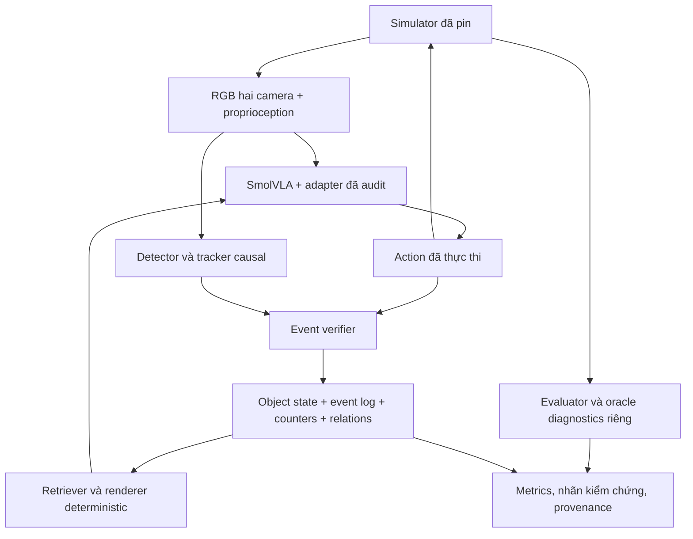

# V2 — SmolVLA với memory cho LIBERO-Mem và giữ năng lực LIBERO base

Ngày: **22/10/2026**. Trạng thái: **implementation plan đề xuất; chưa triển khai hoặc xác nhận hiệu năng**.
Rà soát working tree tại commit `79777de39befd8d426389ea636bd59d4ece7e17c` cùng nguồn tác giả đã pin ở §2.
Các ngưỡng nghiệm thu và cấu hình training bên dưới là lựa chọn nghiên cứu ban đầu, không phải kết quả đo hoặc cấu hình mặc định của benchmark.

## 1. Quyết định và phạm vi thesis

**Hướng chính: fine-tune cùng checkpoint SmolVLA-LIBERO trên dữ liệu trộn LIBERO base + subset LIBERO-Mem, với memory causal được tạo bởi writer có thể chạy online.** Huấn luyện một đối chứng no-memory trên chính các demonstration đó. Bắt đầu bằng T1 và T3; chỉ mở rộng sang identity/occlusion sau khi writer đếm chu kỳ đạt yêu cầu.

Ba câu hỏi cần trả lời độc lập:

1. **Adaptation:** học demonstration của task mới cải thiện bao nhiêu so với checkpoint frozen?
2. **Memory:** với cùng dữ liệu và ngân sách, lịch sử giúp thêm bao nhiêu so với fine-tune no-memory?
3. **Retention:** cùng model sau adaptation còn giữ năng lực manipulation trên LIBERO base trong sai số cho phép không?

Thành công của thesis không được suy từ training loss, một video tốt hoặc kết quả oracle. Cần rollout closed-loop, đối chứng tương xứng và khoảng tin cậy. Memory không bảo đảm sửa được grasp/control failure.

V1 tiếp tục là baseline frozen theo [AGENTS.md](../AGENTS.md). Công việc này thuộc **V2**; không thay benchmark, checkpoint hay controller của V1. Kết quả V2 được gắn `CUSTOM_V2_LIBERO_MEM`; so sánh nội bộ có thể hợp lệ khi cùng protocol, nhưng không tự nhận là reproduction score của paper. Lock hiện có [v2_baseline_lock.yaml](../configs/v2_baseline_lock.yaml) đã ghi `NON-COMPARABLE_OFFICIAL_PAPER`.

**Phạm vi “LIBERO base”:** pilot kiểm tra đủ 10 task LIBERO-10. Kết luận rộng về base phải đánh giá cả Spatial, Object, Goal và LIBERO-10, tổng 40 task. Nếu chỉ có LIBERO-10, viết đúng “retention trên LIBERO-10”; không suy ra toàn LIBERO hoặc LIBERO-90.

## 2. Nguồn đã xác minh và giới hạn của lần rà soát

| Thành phần | Nguồn / revision | Trạng thái |
|---|---|---|
| LIBERO base | `Lifelong-Robot-Learning/LIBERO` @ `8f1084e3132a39270c3a13ebe37270a43ece2a01` | Lock của repository; giữ nguyên |
| SmolVLA-LIBERO | `lerobot/smolvla_libero` @ `31d453f7edd78c839a8bbc39744a292686daf0de` | Lock của pipeline hiện tại |
| Backbone/tokenizer | `HuggingFaceTB/SmolVLM2-500M-Video-Instruct` @ `7b375e1b73b11138ff12fe22c8f2822d8fe03467` | Lock hiện tại |
| Demos base đang dùng | `yifengzhu-hf/LIBERO-datasets` @ `f13aa24a3da8c43c7225569f28c562979fa0e35a` | Đã dùng trong smoke cũ; không đồng nhất với dữ liệu converted pretraining |
| LIBERO-Mem code | [Repository tác giả](https://github.com/libero-mem/libero-mem/tree/0eee0defa4024e51511b6e15a79f30e9620209de) @ `0eee0defa4024e51511b6e15a79f30e9620209de` | Đã đọc source liên quan; chưa chạy simulator |
| LIBERO-Mem annotated | [Dataset tác giả](https://huggingface.co/datasets/libero-mem/LIBERO-Mem/tree/6df130c05b82e09294fa9534e84a069687b72d33) @ `6df130c05b82e09294fa9534e84a069687b72d33` | Đã đọc schema và metadata file; chưa tải/kiểm tra HDF5 |
| LIBERO-Mem Raw | [Dataset raw](https://huggingface.co/datasets/libero-mem/LIBERO-Mem-Raw/tree/61917674055e8b1cbbfd22c1b54c28d20c1a1584) @ `61917674055e8b1cbbfd22c1b54c28d20c1a1584` | Chỉ xác minh revision; không chọn làm đầu vào mặc định |
| Paper | [arXiv:2511.11478v1](https://arxiv.org/html/2511.11478v1) | Dùng đúng phiên bản để truy nguyên nhận định |

Xem [planning source manifest](../resources/manifests/libero_mem_planning_sources.json). SHA256 dữ liệu trong manifest là digest **do upstream công bố**, chưa phải chứng nhận file local đã tải đúng. Trước dùng phải hash lại bytes thực tế, ghi license, môi trường, dataset split và source code của writer.

### 2.1 Những khác biệt có ảnh hưởng trực tiếp đến implementation

1. **Alignment khác converter hiện tại.** Trong `mem_3_refine_demonstration.py`, recorder lưu `obs, action` trước `env.step(action)`; RLDS builder cũng ghép cùng chỉ số. Vì vậy source gợi ý `obs[i] -> actions[i:i+H]`. Converter base hiện tại dùng `obs[i] -> actions[i+1:i+1+H]`. Phải xác minh file phát hành/replay rồi khóa theo từng schema; không dùng chung offset theo tên “LIBERO”. [Refine](https://github.com/libero-mem/libero-mem/blob/0eee0defa4024e51511b6e15a79f30e9620209de/scripts/mem_3_refine_demonstration.py#L873), [RLDS builder](https://github.com/libero-mem/libero-mem/blob/0eee0defa4024e51511b6e15a79f30e9620209de/scripts/__rlds_builder/LIBERO_Mem/LIBERO_Mem_dataset_builder.py#L61).
2. **Đánh giá có state và timing.** `_eval_goal` giữ danh sách subgoal, live/nonlive counters và overshoot. Hàm có thể trả true khi vừa ghi nhận một subgoal; `inc=False` không bảo đảm hoàn toàn không mutation. Không lấy `done` hoặc số predicate đúng ở một frame làm full-task success; không gọi evaluator thêm lần chỉ để log. [Evaluator](https://github.com/libero-mem/libero-mem/blob/0eee0defa4024e51511b6e15a79f30e9620209de/libero/libero/envs/problems/libero_kitchen_tabletop_manipulation.py#L172), [env.step](https://github.com/libero-mem/libero-mem/blob/0eee0defa4024e51511b6e15a79f30e9620209de/libero/libero/envs/bddl_base_domain.py#L913).
3. **Task T3 không được chấm bằng “gripper đóng/mở ba lần”.** BDDL có ba predicate `On` lặp theo Sequence; evaluator xét khoảng predicate đúng/sai. Giữ riêng `observed_cycles` và tiến độ evaluator. Writer không được sao chép oracle progress sang prompt của nhánh thực tế. [BDDL T3](https://github.com/libero-mem/libero-mem/blob/0eee0defa4024e51511b6e15a79f30e9620209de/libero/libero/bddl_files/libero_mem/KITCHEN_SCENE1_3_lift_the_bowl_and_place_it_back_on_the_plate_3_times.bddl#L125).
4. **Entry point evaluation cần audit.** `experiments/robot/libero/run_libero_eval.py` được kiểm tra chưa có nhánh horizon cho `libero_mem`; không coi đó là runner sẵn dùng chỉ bằng thay suite name. Cần xác định call schedule/termination của track Mem từ source và replay, không tự mượn horizon base. [Runner](https://github.com/libero-mem/libero-mem/blob/0eee0defa4024e51511b6e15a79f30e9620209de/experiments/robot/libero/run_libero_eval.py#L173).
5. **Nhãn terminal không phải oracle completion.** Refiner gán `dones[-1]=1`, `rewards[-1]=1` và metadata success khi lưu demo. Không dùng riêng các trường đó để chứng minh toàn chuỗi đã được evaluator xác nhận. [Nguồn ghi nhãn](https://github.com/libero-mem/libero-mem/blob/0eee0defa4024e51511b6e15a79f30e9620209de/scripts/mem_3_refine_demonstration.py#L1045).
6. **Task naming có sai khác giữa tài liệu giới thiệu và release.** Trang dự án mô tả bowl ở T9/T10; task map/BDDL/data release dùng cream cheese. Pilot sử dụng task map + BDDL + HDF5 của revision đã pin; ghi discrepancy, không đổi object cho khớp hình minh họa. [Task map](https://github.com/libero-mem/libero-mem/blob/0eee0defa4024e51511b6e15a79f30e9620209de/libero/libero/benchmark/libero_suite_task_map.py#L1), [trang dự án](https://libero-mem.github.io/).

Đây là phát hiện từ đọc source, **không phải xác nhận file HDF5, camera transform hay dynamics đã đúng**. Mọi uncertainty về state/action/controller/asset phải chặn implementation phụ thuộc và được ghi rõ theo AGENTS.md; không đoán để chạy tiếp.

## 3. Hiện trạng repository và phần tái sử dụng

| Đã có | Tái sử dụng | Cần bổ sung / không được giả định |
|---|---|---|
| `src/memory/{models,store,updater,retriever}.py` | Episode store, provenance, audit, renderer interface | Schema cho persistent identity, relations, cycle counter, evidence availability |
| `src/memory/observation_writer.py` | Tín hiệu phụ về EEF/gripper/action | Chưa đọc ảnh; single-target name không chứng minh đang cầm đúng vật; confidence cố định không phải calibration |
| `src/interfaces/text_memory.py` | Tokenizer thật, audit budget, pass-through | Renderer mới cho count/identity/occlusion; không giữ rule luôn bỏ initial/resting state |
| `src/training/memory_data.py` | Hashing, episode split, padding mask | Loader Mem riêng; không kế thừa offset base hoặc state layout thiếu kiểm chứng |
| `scripts/prepare_memory_sft.py` | Prepare/manifest/shards | Hiện chỉ `libero_10`, `libero_object`; chưa hỗ trợ Mem hoặc replay đủ 40 task |
| `scripts/train_memory_sft.py` | FP16/DDP, official flow-matching loss, expert LoRA/full, resume/export | Mixed-domain sampler, predicted-memory data, chọn checkpoint có retention gate |
| `src/evaluation/rollout.py` | Rollout logs, query/action timing | Mem evaluator adapter riêng; writer chạy mọi observation; log latency/availability |

Pipeline cũ giữ vai trò kiểm tra interface. [Tài liệu SFT hiện tại](V2_MEMORY_SFT_KAGGLE.md) ghi smoke một task LIBERO-Object, 50 demo/7.758 points; chưa phải training LIBERO-Mem hoặc xác nhận 2×T4/rollout sau SFT. Không dùng các con số smoke làm bằng chứng readiness.

## 4. Chọn task và thứ tự mở rộng

LIBERO-Mem đặt bài toán theo bốn dạng lịch sử object: chuyển động (OM), chuỗi/lặp (OS), quan hệ (OR), che khuất (OO). Đây là mô tả của tác giả; lựa chọn pilot bên dưới là đề xuất của thesis. [Nguồn](https://libero-mem.github.io/).

| Giai đoạn | Task theo release | Thông tin memory tối thiểu | Điều kiện mở giai đoạn |
|---|---|---|---|
| A — pilot bắt buộc | T1 bowl một lần; T3 bowl ba lần | Identity bowl/plate từ quan sát; departure, return, count và chu kỳ đang dở | Simulator/evaluator/data contract đã pass |
| B — kiểm tra count | T2/T4 bottle; T5/T6 bowl nhiều lần | Cùng schema, không hardcode số chu kỳ theo task ID | Count chính xác trên held-out trajectories, không double-count |
| C — identity/relations | T7 rồi T8 | Origin binding của từng bowl/plate; map vị trí hiện tại; chuỗi thay đổi quan hệ | Tracker qua giao cắt và che khuất đạt gate |
| D — containment/occlusion | T9 rồi T10 | Vật được đưa vào container nào; container còn lại; trạng thái visibility và bằng chứng empty | Nhớ được containment khi object biến mất; không đoán container từ vị trí mới |

Task ID T1…T10 ở đây là nhãn đọc hiểu, không thay index API 0…9. Manifest phải lưu cả `canonical_task_name`, BDDL hash và index đã resolve.

T1 kiểm tra nhận biết “đã thực hiện một chu kỳ” trên cảnh trở về gần ban đầu; T3 kiểm tra lặp. Pilot A chưa đủ chứng minh memory cho OR/OO. Để kết luận bao phủ bốn dạng, ít nhất cần thêm một task OR và một task OO; nếu không đủ nguồn lực phải thu hẹp claim.

## 5. Kiến trúc và ranh giới thông tin



**Nhánh thực tế mặc định:** chỉ RGB `agentview`/wrist, proprioception đã audit, instruction công khai và action đã thực thi. Không truyền `env` nguyên object vào writer; tạo observation allowlist. Object poses, contacts, simulator IDs, segmentation IDs, reward, `done`, subgoal flags, future action và task index không được làm input writer/policy. Instruction có thể nêu mục tiêu nhưng không phải bằng chứng mục tiêu đã xảy ra.

Mask/box/ID/depth từ dữ liệu tác giả là supervision hoặc diagnostic. Detector được học từ nhãn train rồi dự đoán từ RGB online là hợp lệ nếu công khai supervision. Feed trực tiếp simulator masks/depth/IDs tạo track đặc quyền hoặc thay đổi sensor contract, phải báo riêng. Đặc biệt không “rửa” oracle qua một chuỗi text rồi gọi đó là observation memory.

Writer chỉ mô tả bằng chứng và belief. Nó không xuất action, không thay instruction bằng “next subgoal”, không chọn grasp/recovery waypoint, không ra lệnh stop từ oracle count. Evaluator chấm điểm độc lập. Retriever được chọn fact liên quan từ instruction và lịch sử, không đọc tiến độ chuẩn.

## 6. Writer cần gì để ghi đúng và trung thực?

### 6.1 Các module tối thiểu

| Module | Nhiệm vụ cụ thể | Failure cần lộ ra |
|---|---|---|
| Observation contract | Timestamp/frame index/camera identity; đồng bộ RGB và proprio; khai báo orientation/resolution | Missing frame, camera lệch, action/obs offset sai |
| Object detector/segmenter | Localize bowl, bottle, plate, basket, cheese và gripper từ ảnh | Không thấy, confidence thấp, distractor giống target |
| Persistent tracker | Liên kết instance qua thời gian và hai camera; giữ origin binding | ID switch, merge/split, mất track, re-identification mơ hồ |
| Relation estimator | `on`, `in`, `held`, vị trí tương đối; visibility riêng với existence | Bbox chồng nhau nhưng vật nằm cạnh/ngoài container |
| Temporal event verifier | Ghép bằng chứng trước–sau, hysteresis, dwell, disarm/rearm | Gripper đóng hụt, vật trượt, bounce, lặp frame |
| Belief updater | Fact confirmed/uncertain/unknown/stale/retracted; đếm và sửa sai có provenance | Mâu thuẫn mới không được ghi đè âm thầm |
| Retriever/renderer | Chọn fact còn ý nghĩa; giữ qualifier, token budget và exact no-memory | Cắt mất phủ định/count/identity binding |

**Implementation pilot đề xuất:** một detector/segmenter compact học từ masks/boxes của train split, kèm tracker online dựa trên mask overlap, appearance, chuyển động và bằng chứng hai camera; event FSM deterministic. Thử riêng trường hợp một bowl trước. Chỉ chọn model perception cụ thể khi đã kiểm tra license, official checkpoint/hash, input contract và tốc độ trên phần cứng đích. TAPIR/VLM không phải dependency bắt buộc; point tracker đơn lẻ cũng không xác nhận placement hoặc semantic identity.

Không dùng centered temporal window, bidirectional tracking, smoothing từ frame tương lai hoặc tracking offline rồi gán ngược identity để tạo nhánh predicted-memory. Có thể dùng chúng để làm annotation diagnostic, với source label riêng.

### 6.2 Identity phải gắn với vật, không gắn với vị trí hiện tại

- Tạo ID nội bộ episode-local khi vật được quan sát lần đầu; không lấy tên asset ẩn làm ID policy-visible.
- Gắn alias dễ hiểu với bằng chứng: “bowl ban đầu trên plate bên trái”; vị trí trái/phải dùng camera/frame quy chiếu đã khóa. Origin anchor bất biến, current location có thể đổi.
- Không đổi tên “bowl A” thành “bowl B” khi chúng hoán đổi chỗ. Plate/container chuyển động cũng cần persistent ID.
- Đưa ID trừu tượng vào text chỉ khi policy có cách nối nó với ảnh: anchor ngôn ngữ và current relation/bbox phù hợp. `bowl_2` đơn độc không có grounding.
- Khi hai vật giống nhau biến mất/giao cắt và không đủ bằng chứng: giữ tập giả thuyết hoặc `identity_unknown`; không khôi phục từ task order/asset ID. Báo số lần ambiguity và tỷ lệ abstain.
- Một object tên trong instruction không có nghĩa gripper đang giữ nó. Writer phải kiểm tra object thực sự đồng chuyển động; distractor vẫn có thể bị gắp.

### 6.3 Event ontology và bằng chứng

Các điều kiện dưới đây là thiết kế perception của thesis; không thay predicate vật lý của benchmark. Ngưỡng độ dài/dịch chuyển/dwell phải fit ở train/calibration rồi freeze, dùng đơn vị giây hoặc frame được quy đổi rõ.

| Event | Bằng chứng cần có để xác nhận | Không đủ để xác nhận |
|---|---|---|
| `grasp_attempt` | Lệnh đóng đã thực thi + quan sát gripper tiếp cận | Không đồng nghĩa grasp success |
| `held` | Instance quan sát được ở vùng gripper, đồng chuyển động bền vững; proprio hỗ trợ | Finger gap bị chặn; EEF nâng lên; tên target trong instruction |
| `departed_support` | Vật đã được thấy trên support, sau đó rời quan hệ support với identity nhất quán | Một frame detector mất vật |
| `lift_observed` | Object motion và thay đổi quan hệ với mặt đỡ, được xác nhận qua chuỗi ảnh | Chỉ tăng EEF z; bbox đổi kích thước không rõ nguyên nhân |
| `release_attempt` | Lệnh mở đã thực thi | Chưa được tăng completed count |
| `returned_to_support` | Cùng vật/support; departure đã ghi nhận; return ổn định qua nhiều obs | Vật ở trên plate lúc reset, bbox overlap tức thời |
| `placement_verified` | Quan hệ đích ổn định; bằng chứng vật được đỡ/không còn theo tay khi quan sát cho phép | EEF ở đích hoặc opening command |
| `slip_or_drop` | Đã có held/lift; sau đó object tách tay, chuyển động/quan hệ thay đổi được quan sát | Không thấy do occlusion; gripper gap đơn lẻ |
| `entered_container` | Theo dõi object đi vào container đã định danh; placement/relation evidence đủ | Object biến mất cạnh rổ hoặc chỉ bbox giao nhau |
| `occluded` / `reappeared` | Thay đổi visibility của track; không đồng nhất visibility với existence | Xóa vật khi mất detection |
| `relation_changed` | Cùng identity, quan hệ nguồn/đích được kiểm chứng | Suy thứ tự đúng từ instruction |

Không cần cưỡng ép `held` phải đúng mới ghi mọi event khác: benchmark có thể ghi nhận return-to-support dù grasp không được nhìn rõ. Giữ riêng bằng chứng về motion/relation với bằng chứng grasp; không thêm điều kiện “tay đã mở” vào metric official nếu evaluator không có điều kiện đó.

### 6.4 Đếm chu kỳ bằng chuyển trạng thái, không bằng số frame hoặc số lệnh

FSM đề xuất cho T1/T3:

```text
support_observed (count=0 nếu đã quan sát từ reset)
  -> departure_candidate
  -> departure_confirmed
  -> return_candidate
  -> return_confirmed: ghi đúng một cycle_id; count += 1
  -> support_observed, chờ departure mới để rearm
```

- Một chu kỳ cần cùng object/support, một departure mới và một return đã xác nhận; duplicate frame/requery không tạo chu kỳ mới.
- Không reset candidate chỉ vì một frame nhiễu; dùng hysteresis. Không cho detector mất vật kích hoạt departure nếu chỉ có occlusion.
- `cycle_in_progress`, `confirmed_cycles`, `history_complete`, `uncertain_cycle_count` là các trường riêng. Count là số **đã quan sát xác nhận**, không tự đồng nhất số thật khi history thiếu.
- Nếu đoạn đầu demo bị cắt, không khởi tạo “đã làm 0 lần”; ghi `history_complete=false`. Loại sample cần total count khỏi pilot chính hoặc dùng nhánh uncertainty đã thiết kế rõ.
- Nếu evidence bị bác bỏ, append correction/retraction liên kết event cũ; recompute count projection có version. Không sửa prompt quá khứ hoặc giảm count không log.
- Physical event có thể xảy ra ở frame u nhưng cần đến frame v mới xác nhận: `occurred_at=u`, `available_at=v`. Prompt tại u không được biết fact chỉ có ở v.
- Bộ đếm evaluator và bộ đếm quan sát có thể lệch vì semantics/dwell; ghi độ lệch và điều tra, không “sửa” writer bằng cách đọc evaluator.

### 6.5 Containment, trạng thái rỗng và fact lâu dài

OO cần **nhớ vật thuộc container nào sau khi vật bị che**, không chỉ nhớ tọa độ vật ở frame cuối. Giữ cạnh `last_confirmed_in(object, container)` cùng thời điểm, nguồn và trạng thái quan sát. Khi container di chuyển, quan hệ containment có thể còn là belief hợp lý; vị trí object hiện tại là suy luận theo container, không giả là vừa nhìn thấy.

`not_visible` không có nghĩa `empty`. Muốn khẳng định empty cần quan sát được interior hoặc một chuỗi loại trừ có giả định đầy đủ đã công khai. Khi không đủ, ghi “chưa quan sát vật được đưa vào B”, không viết “B chắc chắn rỗng”. T10 phải kiểm tra riêng lỗi này.

Historical fact như “đã hoàn thành hai chu kỳ” không hết hạn chỉ vì qua 200 steps. Ngược lại, vị trí hiện tại/held phải mất độ tin cậy khi evidence cũ hoặc xuất hiện mâu thuẫn. Không dùng một TTL chung cho mọi loại fact; current-state cache và event history có quy tắc khác nhau.

### 6.6 Confidence, abstention và trung thực

`confirmed` nghĩa là đã qua tiêu chuẩn của writer với precision được đo, không đồng nghĩa ground truth. Tách score thô, mức confidence đã calibration và độ tin cậy identity/relation. Nếu chưa calibration, để trường probability là null; không tự gán 0.9 hoặc gọi confidence heuristic là calibrated.

Calibration lấy từ episode riêng, gồm success, grasp miss, slip, wrong object, occlusion và duplicate detections. Báo precision/recall, coverage, delay và lỗi theo lớp. Một writer không bao giờ phát event có precision không xác định và coverage bằng 0; không được xem là tốt.

Thiếu evidence hợp lệ tạo `unknown/uncertain`, là trạng thái bình thường của perception. Thiếu resource, tensor/schema sai hoặc camera contract không biết là lỗi hệ thống: dừng run, không dùng fallback để phát fact.

## 7. Memory schema và prompt

### 7.1 Ba lớp lưu trữ

1. **Evidence/event log append-only:** nguồn frame/camera, score, transition, ID associations, candidate/retraction. Dùng kiểm toán và dựng lại state.
2. **Structured episode memory:** object table, current relations, last-confirmed relations, origin anchors, counters và ordered event references. Không lưu chain-of-thought hoặc prose suy đoán.
3. **Policy text view:** một bản rút gọn deterministic, chỉ chứa dữ kiện liên quan đã có trước query. Full audit không cần nhét vào token budget.

Schema minh họa dưới đây là interface dự kiến, **không phải recording thật hoặc format official**:

```yaml
schema_version: 2
episode_id: example_only
as_of_observation: 182
last_consumed_action: 181
history_complete: true
objects:
  bowl_A:
    origin_anchor: bowl initially on the left plate
    identity_status: tracked
    visibility: visible
relations:
  - subject: bowl_A
    predicate: on
    object: plate_A
    status: confirmed_by_writer
    available_at: 182
    evidence_ids: [agentview_180, agentview_181, wrist_182]
cycles:
  bowl_A_plate_A:
    confirmed: 2
    in_progress: false
    history_complete: true
    event_ids: [cycle_1, cycle_2]
events:
  - id: cycle_2
    type: returned_to_support
    occurred_at: 180
    available_at: 182
    source: predicted_rgb_tracker
    probability: null
    supersedes: null
```

Artifact thực tế còn phải ghi `writer_revision`, perception checkpoint SHA256, threshold config hash, source indices, timestamps/availability wall-clock và renderer revision. Nhãn `probability: null` nghĩa chưa calibration, không phải event tự động hợp lệ.

### 7.2 Nội dung text theo từng bài toán

Giữ instruction gốc bằng tiếng Anh như checkpoint; append một block factual ngắn. Ví dụ minh họa, chưa chứng nhận vừa token budget:

| Bài toán | Nội dung có thể render khi đủ evidence |
|---|---|
| Count | `Memory: bowl returned to its original plate twice; no cycle in progress.` |
| Count chưa chắc | `Memory: two returns confirmed; one later return uncertain.` |
| Identity/relations | `Memory: the bowl originally on the left plate is now on the empty plate.` |
| Occlusion | `Memory: cheese was placed in the left basket; cheese is now hidden.` |
| Container di chuyển | `Memory: the basket that received the cheese is now at center.` |

“Đã đặt trên đĩa” không có nghĩa task hoàn tất nếu phải lặp; “đã làm 2 lần” không có nghĩa writer ra lệnh làm lần 3. Không render `next_goal`, `subgoal_id`, `remaining_steps`, vị trí đích lấy từ evaluator, time-to-end hoặc success flag. Con số target yêu cầu vốn đã ở instruction; số completed phải có event evidence.

Không serialize `episode_id`, demo number, frame index, elapsed steps hoặc simulator IDs vào prompt: chúng có thể trở thành shortcut đếm tiến độ. Timestamp dùng trong audit/retrieval; nếu cần thể hiện stale, dùng qualifier và ablation rõ.

### 7.3 Token budget và cách xử lý thiếu chỗ

Contract hiện tại là **48 token cho instruction + memory**, dùng đúng tokenizer/newline/special tokens. Cần đo trên toàn train/val: instruction length, p50/p95/max tổng token, số fact quan trọng bị bỏ và tỷ lệ prompt bị cắt.

Thứ tự ưu tiên phụ thuộc bài toán: count + in-progress cho OS; identity binding + changed relations cho OR; containment + visibility cho OO. Không mặc định recovery event luôn chiếm chỗ của count. Instruction không bị cắt; qualifier không bị bỏ để fact vừa budget.

Nếu 48 token không đủ cho state tối thiểu, **dừng prepare của cấu hình đó**. Có thể thiết kế ablation 96 token sau audit official model/processor, positional handling và export/reload; đây là thay đổi V2 công khai. Áp dụng cùng cấu hình cho cả nhánh FT memory/no-memory, kiểm lại retention. Không chỉ đổi manifest hoặc renderer khi trainer còn assert 48; không âm thầm truncate bằng tokenizer.

Base replay mặc định dùng instruction nguyên bản; no-memory đi qua không thêm suffix. Trên base rollout, đo riêng memory off và writer on; nếu chỉ off đạt retention thì claim phải nói rõ đó là retention khi memory tắt.

## 8. Dataset causal và ngăn rò rỉ thông tin

### 8.1 Chuẩn hóa từng nguồn trước khi trộn

Tạo canonical record `o_t, executed_history_{<t}, instruction, memory_available_at_t, action_chunk_t`. Ánh xạ source index phải lưu trong mỗi sample. Với Mem refined, source cho thấy offset 0; với base raw hiện tại là +1. Chỉ publish prepared dataset khi replay/file audit xác nhận mapping này.

Đối chiếu bắt buộc: RGB channel order/flip/rotate, agentview và wrist ordering, native resolution, proprio quaternion/axis-angle và thứ tự, action units/order/gripper sign, original normalizers. `get_visual` của refiner có flip riêng; không áp dụng thêm 180° như base chỉ vì cùng tên camera. So ảnh vật lý cùng state với tensor trước model; không sửa benchmark camera để che lỗi converter.

Writer tại t được đọc `o_0…o_t` và **actions đã thực thi trước t**. `a_t…a_{t+H-1}` chỉ là target SFT. Nếu recorder chứa action ở cùng row observation, action đó vẫn là tương lai đối với writer. Padding chunk phải dùng mask official, không vượt episode; giữ terminal/hold demonstrations hợp lệ để model có cơ hội học dừng lặp.

### 8.2 Split và supervision

- Tác giả mô tả 100 train/20 validation mỗi task. Phải resolve danh sách demo cụ thể từ release, không suy từ demo number. Builder đang dùng set intersection nên không xem thứ tự iterate là split ổn định. [Project](https://libero-mem.github.io/), [builder](https://github.com/libero-mem/libero-mem/blob/0eee0defa4024e51511b6e15a79f30e9620209de/scripts/__rlds_builder/LIBERO_Mem/LIBERO_Mem_dataset_builder.py#L103).
- Nếu không có mapping official tái lập được, tạo split theo episode/initial-state hash có manifest và gắn **CUSTOM_SPLIT**; không gọi là official 100/20.
- Group các bản replay/copy cùng trajectory, initial-state và video trùng; không random split theo frame. Không dùng held-out rollout để chọn threshold, checkpoint hoặc mixture ratio.
- Chia train adaptation thành phần fit perception và calibration/development. Với dữ liệu ít, dùng cross-fitting theo episode group để memory dự đoán cho policy train không chỉ là output trên ảnh detector đã thuộc; sau đó đóng băng recipe và tái đánh giá writer dùng online.
- Test cuối không dùng cho writer, policy, renderer hoặc chọn hyperparameter. Nếu release chỉ có train/val, dành validation nội bộ từ train; giữ official val cho final khi protocol cho phép. Không quảng cáo một custom holdout là official test split.

### 8.3 Hai dòng memory, một danh sách demonstration chung

| Dòng dữ liệu | Cách tạo | Dùng để làm gì |
|---|---|---|
| `predicted_memory` | Stream ảnh từ đầu tới t qua chính writer online, đúng sampling/latency | Train/eval nhánh chính |
| `oracle_memory` | Facts tại t từ annotations/simulator đã audit; cũng không được đọc tương lai | Chẩn đoán giới hạn perception; luôn đánh dấu privileged |
| `no_memory` | Cùng sample IDs/actions, instruction nguyên bản | Đối chứng chính |

Annotation subgoal, interaction count, simulator segmentation hoặc `success=True` không mặc nhiên là count chu kỳ đúng. Cần đọc cách sinh từng field; không dùng `convert2texts(reasoning)` rồi coi text là memory tự quan sát. Nhánh oracle cũng chỉ serialize fact quá khứ, không đưa “subgoal tiếp theo”. Paper nêu rõ bản Naive E-SlotSSM dùng oracle subgoal; kết quả đó không chứng minh hệ thống tự phát hiện subgoal. [Paper, phần Action Control và Limitations](https://arxiv.org/html/2511.11478v1).

Nếu writer không có fact/abstain, giữ sample với empty/uncertain memory và giữ cùng sample ở no-memory; báo coverage. Không lọc chỉ sample dễ cho nhánh memory. Sample bị loại vì contract/alignment/history thiếu phải bị loại nhất quán ở mọi nhánh chính và có reason.

Output dự kiến: `sources.lock.json`, `split.json`, `manifest.json`, `samples.jsonl`, `writer_events.jsonl`, `shards/`, `qa_report.md`. Manifest có task/domain, source hash, camera/state/action contract, transform version, writer/renderer hash, memory source, input availability, token stats, exclusions và episode/sample counts.

## 9. Training để giữ base performance

### 9.1 Recipe chính

Khởi tạo mọi nhánh FT từ cùng checkpoint gốc. Bắt đầu bằng expert LoRA, VLM frozen, official flow-matching loss. Normalization stats, image processing, action decode và robot/controller contract không đổi âm thầm.

Trộn **50% sample base, 50% sample Mem** làm preset đầu, cân bằng task trong từng domain. Đây là hyperparameter đề xuất. Không concat frame rồi để task dài áp đảo. Cố định sample schedule, số update, effective batch, optimizer/LR, augmentation, padding và seeds giữa hai nhánh FT. Nếu oversample event boundaries, áp dụng cùng sample IDs/weights ở cả hai nhánh.

Base replay chọn demonstration có provenance từ các suite nằm trong claim retention; pilot ưu tiên LIBERO-10, giai đoạn rộng thêm Spatial/Object/Goal sau converter audit. Không dùng evaluation episodes làm replay. Image resize/data-source khác pretraining phải ghi rõ; giữ đối chứng cùng dữ liệu.

| Tham số pilot | Giá trị đề xuất / điều kiện |
|---|---|
| Trainable | Official expert LoRA targets; xuất danh sách thực tế và trainable count |
| Rank / alpha | 16 / 16, kế thừa preset hiện có |
| LR | `1e-4`, warmup 100 updates; kiểm tra stability trước run dài |
| Global batch | 32 nếu 2×T4 smoke pass; batch2/GPU × accumulation8 |
| Precision | FP32 weights + FP16 AMP/GradScaler; DDP không cộng VRAM hai GPU |
| Ngân sách đầu | 2-step smoke riêng, sau đó tối đa 3.000 optimizer updates/nhánh |
| Checkpoint | Mỗi 500 updates; chọn bằng development rollout và retention gate |
| Action chunk / execution | H=50; khởi đầu s=10 như lock hiện tại, sau Mem contract audit |
| Memory dropout | **0 trên Mem pilot**, base samples vốn là instruction-only |
| Seeds | Pilot 1 seed để debug; kết luận chính dùng ít nhất 3 training seeds nếu khả thi |

Không bỏ memory ngẫu nhiên 0.2 khi đó là thông tin duy nhất phân biệt đúng/sai. Muốn robustness với missing/noisy memory phải thiết kế một ablation riêng và nhãn có ý nghĩa; không biến một observation thiếu history thành sample có đáp án duy nhất giả tạo.

### 9.2 Bảo toàn base có kiểm chứng

Chọn checkpoint theo bài toán có ràng buộc:

```text
maximize development LIBERO-Mem metric
subject to base retention criterion passed
```

Không chọn checkpoint chỉ vì Mem loss thấp nhất. Nếu base giảm, tăng base replay lên 75%, giảm LR/early-stop trên development và áp dụng lại ngân sách lựa chọn cân bằng cho đối chứng. Chỉ khi vẫn cần mới thêm regularization/distillation từ frozen teacher trên **base** samples; flow-matching distillation phải dùng cùng timestep/noise và mask, công thức/lambda được ghi riêng. Không distill teacher không có memory trên Mem như thể teacher biết hành động đúng.

Nếu oracle causal memory đã đúng mà policy vẫn không dùng được, kiểm tra token/grounding và sample tương phản trước. Sau đó mới thử expert full hoặc LoRA ở một phần language backbone; cần audit target modules, VRAM và matched no-memory control mới. Không mặc định expert LoRA đủ, cũng không mở toàn backbone ngay.

**Checkpoint routing chỉ là phương án triển khai phụ:** giữ model gốc cho base và model mới cho Mem có thể bảo vệ service base, nhưng không chứng minh cùng model đã giữ kỹ năng. Thesis chính đánh giá một checkpoint FT chung. Không âm thầm đổi checkpoint theo suite rồi báo retention.

## 10. Online rollout và chênh lệch train–test

Ở mỗi observation t: ingest bằng chứng mới và action đã thực thi trước đó; xác nhận event đủ điều kiện; dựng memory chỉ từ facts đã available; khi đến query boundary, đóng băng snapshot cho chunk kế tiếp. Các observation giữa hai query vẫn cập nhật writer. Log thời điểm nhận evidence, commit event, render prompt, query policy và execute action.

Giữ s=10 cho các nhánh chính sau audit. Nếu event xảy ra giữa chunk, memory chỉ tác động từ query tiếp theo. So sánh s=5 hoặc s=2 chỉ là ablation chung cho cả nhánh; không bật event-triggered replanning riêng cho memory rồi quy toàn gain về memory content.

Train predicted-memory bằng cùng writer frozen, frame sampling, reset/warmup và confirmation delay như rollout. Nếu worker perception chạy bất đồng bộ, một frame đã chụp nhưng chưa xử lý xong chưa được tính available. Precompute offline không được cấp fact sớm hơn cơ chế online dự định.

Chạy shadow writer trên một tập rollout development của chính policy để đo lỗi ở failed grasps, vật văng, occlusion và ID switch ngoài demo distribution. Có thể dùng các frame train/development đó để cải thiện **writer**, có split/provenance riêng. Không đưa action từ failure rollout vào BC như expert target. Mỗi lần đổi writer phải version lại memory data và tái kiểm train–online parity.

Báo p50/p95 writer latency, policy latency, tổng episode wall time, số missed frames và memory age. Nếu simulator được pause trong lúc inference, nói rõ; không suy từ đó rằng hệ thống đạt điều khiển real-time 20 Hz.

## 11. Ma trận thí nghiệm và metric

### 11.1 Các nhánh tối thiểu

| ID | Training | Memory lúc rollout | Vai trò |
|---|---|---|---|
| B0 | Frozen SmolVLA-LIBERO | Off | Điểm xuất phát trên base và Mem |
| F0 | Base + Mem, không memory | Off | Lợi ích task adaptation |
| F-frame | Cùng samples/budget, thêm facts từ frame hiện tại | Cùng perception nhưng không giữ history | Tách lợi ích perception/extra text khỏi lợi ích memory |
| F1 | Cùng samples/schedule, predicted memory trên Mem | Predicted writer | Hệ thống thesis chính |
| F1-off | Chính checkpoint F1 | Off | Kiểm tra phụ thuộc history; đây là ablation OOD, không thay đối chứng F0 |
| O1 | Cùng demos, causal oracle memory | Oracle | Diagnostic privileged, không trộn vào score hệ thống |

Pilot kỹ thuật có thể chạy B0/F0/F1 trước; **F-frame cần cho claim mạnh rằng gain đến từ lịch sử**, vì F1 còn được hỗ trợ bởi perception đã học thêm. Dùng cùng detector, schema text và token ceiling; không cấp count/origin/containment quá khứ cho F-frame. Nếu không làm đối chứng này, chỉ kết luận lợi ích của toàn hệ thống memory + perception. Ghi riêng compute/nhãn dùng để huấn luyện writer; matched policy budget không đồng nghĩa tổng chi phí các hệ thống bằng nhau.

Nếu có ngân sách, thêm O1 với predicted memory để đo train–test gap; F1 với oracle memory để chẩn đoán lỗi writer có điều kiện, nhưng không coi đó là upper bound được bảo đảm. Oracle có thể đổi distribution. History ngắn là một ablation bổ sung về temporal horizon.

Shuffle count/identity hoặc thay memory đúng–sai trên matched observations là **counterfactual diagnostic**, không benchmark score. Giữ instruction/state/current image tương đương, noise seed giống nhau khi so action; đo hành vi quyết định qua rollout thay vì yêu cầu action vector phải y hệt demo. Không sửa hình hoặc task official để tạo số benchmark mới.

### 11.2 Metric chính và gate đề xuất

| Mục tiêu | Đo gì | Tiêu chí đề xuất |
|---|---|---|
| Data integrity | Hash, schema, obs/action indices, finite tensors, token truncation | Không mismatch; không future leakage; không truncation cần thiết |
| Writer event | Precision/recall theo event; abstention/coverage; availability delay | Pilot: precision điểm ≥98%, recall ≥90%; công bố CI và support, không chỉ macro trung bình |
| Count | Exact count tại decision points, exact toàn episode, over/under-count | ≥95% episode held-out có count đúng ở mọi decision point; không chấp nhận double-count do duplicate input |
| Identity/OO | ID switches, identity accuracy, containment accuracy khi occluded, false-empty rate | Gate riêng trước mở task OR/OO; không dùng gate count thay thế |
| Base retention | Δbase = SR(F1) − SR(B0), cùng task/init/protocol | Margin đề xuất δ=3 điểm phần trăm; cận dưới CI một phía 95% của Δbase ≥−δ |
| Memory benefit | ΔMem = metric(F1) − metric(F0) | Dùng SCR/sequence metric đã audit làm primary pilot; cận dưới CI 95% >0 để claim gain xác nhận |
| Hoàn thành task | Full-task success, ordered progress, overshoot và stop behavior | Báo riêng; SCR tăng chưa có nghĩa full task hoạt động tốt |

Ngưỡng writer là engineering targets ban đầu; không đạt thì cải thiện writer/thu hẹp scope, không hạ ngưỡng sau khi xem test. Nếu support nhỏ hoặc CI rộng, kết luận “chưa đủ bằng chứng”. Kiểm tra coverage ở đúng điểm cần memory để tránh metric tốt trên phần dễ.

Để cụm “hoạt động tốt” có nghĩa đo được, đặt mục tiêu pilot **full-task SR ≥70% trên mỗi T1/T3 và gain SCR ≥10 điểm phần trăm so F0** như target kỹ thuật đề xuất, báo CI và giá trị tuyệt đối. Đây không phải ngưỡng official hoặc bảo đảm đạt được. Nếu không đạt vẫn có kết quả nghiên cứu, nhưng claim phải là cải thiện một phần; trước mở rộng khóa target phù hợp từng nhóm task.

Đánh giá paired trên cùng official init-state IDs và policy-noise seeds; training seeds là một nguồn biến thiên khác. Dùng bootstrap theo episode/initial-state groups, giữ pairing và báo biến thiên qua training seeds; không coi hàng nghìn frame là mẫu độc lập. Báo task-level, macro theo suite và worst regressions; aggregate không được che task sụt mạnh.

Pilot 5 initial states chỉ để screening. Final base dùng đủ 50 states/task nếu muốn claim trên bộ init states chính thức đã khóa; nhiều lần seed trên cùng state không tạo thêm scene độc lập. Với Mem, dùng đúng số/list init states thực tế được xác minh, không áp mặc định 50 của base. Chốt selection/development và final evaluation trước training; tập eval đã dùng tune không được gọi untouched test.

Giữ riêng định nghĩa SCR của evaluator tác giả sau audit và diagnostic count/lift/place của writer. Lưu progress trace, số subgoal hợp lệ, nhánh OR, final-state validity, overshoot và lý do terminal. Không cộng các predicate bất kỳ hoặc chọn mẫu số sau khi nhìn kết quả.

## 12. Evaluator gate đặc biệt cho LIBERO-Mem

P1 phải tạo một báo cáo executable conformance, không chỉ kiểm tra import:

1. Resolve BDDL, init states, assets, robot/controller và package path từ checkout Mem riêng. Không cài hai package `libero` vào cùng environment; giữ base simulator riêng. Thêm env Mem và perception riêng nếu dependency cần; policy/training không được nâng môi trường base.
2. Replay demonstration thật; đối chiếu progress tại từng event. Trace số lần `_check_success(inc=True/False)` do step/reward/logger gây ra. Logger chỉ đọc snapshot, không tự advance evaluator.
3. Kiểm T1/T3: trạng thái đã đúng ở reset không được hiểu thành đã làm chu kỳ; partial progress không bị đánh đồng với full success; repeated predicate phải đòi event phù hợp theo code đã pin.
4. Kiểm reset giữa episode, bao gồm `_overshot`, counters và satisfied list. Source `reset_subgoal_progress` được đọc chỉ reset list/counters; phải kiểm lifecycle reset đầy đủ của env, không kết luận isolation từ tên hàm.
5. Kiểm OR semantics và call-order effects trước T7–T10; source prefix helper dùng tập hợp, nên cần đối chiếu trajectory thật thay vì giả định nó kiểm ordered prefix hoàn chỉnh.
6. Khóa full-sequence completion, horizon, warmup, dwell, termination/overshoot policy bằng bằng chứng upstream + replay. Nếu chưa xác định được, **chặn training/benchmark Mem**; không dùng `done=True` như shortcut.
7. Nếu phải sửa lỗi upstream hoặc thêm wrapper làm đổi scoring, ghi patch hash và kết quả `NON-COMPARABLE_TO_UPSTREAM`; giữ raw upstream trace và metric sửa riêng. Không thay bằng evaluator tự viết rồi gọi official.

Synthetic event traces được phép làm unit test FSM/adapter; không phải demonstration hoặc nguồn benchmark score. Các replay và score phải dùng resource thật.

## 13. Backlog triển khai với deliverable và điều kiện chuyển bước

Các đường dẫn mới dưới đây là **dự kiến, chưa tồn tại**. Không dùng checklist này như chứng nhận đã triển khai.

| Phase | Work item / file dự kiến | Deliverable | Điều kiện hoàn tất |
|---|---|---|---|
| P0 — khóa phạm vi | `configs/benchmarks/libero_mem_pilot.yaml`; full resource lock | Task T1/T3, protocol draft, nguồn và data budget | Không hash/asset/interface nào bị đoán; blocker list có owner/action |
| P1 — environment/evaluator | `src/simulator/libero_mem_env.py`; `src/evaluation/libero_mem_metrics.py`; `scripts/audit_libero_mem.py`; env Mem riêng | Conformance report, real-demo replay, controller/camera/state/action contract | §12 pass; chưa pass thì không train |
| P2 — canonical data | `src/training/libero_mem_data.py`; `scripts/prepare_libero_mem_sft.py` | Source/split locks, aligned shards, sample QA | Replay audit offset/orientation; 0 leakage/cross-split duplicate |
| P3 — oracle diagnostic | `src/memory/libero_mem_oracle.py`; annotation review | Oracle causal event timelines + policy learnability pilot | Fact labels khớp history; privileged rõ; không “next subgoal” |
| P4 — predicted writer | `src/perception/object_tracker.py`; `src/memory/event_writer.py`; schema v2; tests | Detector/tracker frozen, event precision/coverage/delay report | Gate count + temporal tests pass trên held-out episodes |
| P5 — text/data parity | `src/interfaces/libero_mem_text.py`; renderer/tokenizer audit | Predicted memory shards và streaming replay parity | Prompt đúng prefix; mọi fact có evidence available trước query |
| P6 — mixed SFT | Mở rộng trainer/dataset/sampler hiện có, training config riêng | F0/F1 matched runs; strict export/reload; logs tài nguyên | 2×T4 smoke pass rồi mới chạy ngân sách pilot |
| P7 — closed-loop | Mem runner riêng + base paired evaluation | SR/SCR/CI, base retention, failure taxonomy, latency | Phân biệt data/writer/policy/controller/evaluator failures |
| P8 — mở rộng | T2/T4–T6, rồi T7/T8 và T9/T10 | Báo cáo theo memory dimension, scope claim cập nhật | Gate identity/OO riêng; giữ retention checks mỗi lần mở scope |

P2 chuẩn hóa observation đi trước việc gắn memory; bản predicted-policy training chỉ được chạy sau P4/P5. P3 oracle diagnostic có thể dùng để xác định policy có học được thông tin lịch sử, nhưng không thay nghiệm thu P4. Không train lớn trong lúc evaluator, writer hoặc token grounding chưa qua gate.

Các việc đầu tiên theo thứ tự: khóa task/resources; audit evaluator và replay; audit loader bằng một demo thật; tạo annotation timeline cho T1/T3; kiểm writer; chuẩn bị hai dataset view; smoke FT; rollout development; mới mở rộng.

## 14. Verification cần triển khai

| Nhóm kiểm thử | Trường hợp bắt buộc |
|---|---|
| Causality | Xử lý prefix 0…t cho cùng memory với stream đến t; sửa suffix tương lai không đổi prefix; action target không lọt writer |
| Availability | Confirmation cần frame v không xuất hiện trong prompt trước v; mô phỏng processing delay không cho evidence đi ngược thời gian |
| Count | Reset đúng, missed grasp, slip, open tại sai chỗ, bounce, duplicate frame, stale frame, partial history, retraction |
| Identity | Hai vật giống nhau đổi chỗ, crossing, occlusion/reappearance, multi-camera disagreement, container di chuyển |
| Truthfulness | Không thấy vật không tạo empty; chỉ target name không tạo identity; uncertain không render thành confirmed |
| Isolation | Reset xóa state episode trước; policy/writer không đọc oracle fields; evaluator đọc log không làm tăng progress |
| Dataset | Obs/action offset đúng theo nguồn, không double flip, normalizers giữ nguyên, chunk mask, split theo groups |
| Prompt | Instruction nguyên bản khi off; thật sự tokenize đủ; không mất qualifier, identity binding hoặc count vì budget |
| Training/export | Cùng sample schedule F0/F1, trainable params đúng, resume/reload, finite `(50,7)`, hash processors/stats |
| Benchmark | Replay dữ liệu thật, full vs partial success, overshoot/reset, OR paths, base regression |

Các lệnh governance đã có vẫn dùng: `pytest -q tests/test_project_structure.py` và `python scripts/validate_project.py`. Simulation smoke và system/environment checks phải chạy trong đúng isolated env. Plan này không đưa lệnh `prepare --suite libero_mem` giả như CLI hiện tại đã hỗ trợ.

## 15. Tài nguyên, quyết định dừng và đầu ra thesis

Metadata upstream cho T1 khoảng **9,67 GB**, T3 **18,43 GB**, `metainfo.json` **0,714 GB**: tổng **28,81 GB decimal** trước checkpoint, prepared shards, base replay và dependencies. Số liệu này là file sizes từ Hub, chưa tải data. Prepare trên storage đủ lớn, stream/chunk HDF5 và chỉ đóng gói trường cần thiết cho policy; nhãn/evidence đầy đủ giữ ở artifact audit. Không đưa cả dataset Mem lên Kaggle mặc định và không xóa raw data để giải phóng chỗ tự động.

| Quan sát | Quyết định tiếp theo |
|---|---|
| Demo replay/evaluator không nhất quán | Dừng Mem training; giải quyết source contract/bug và nhãn comparability |
| Oracle tốt, predicted kém | Sửa perception/event verification hoặc train–test mismatch; không mở backbone để che writer sai |
| Oracle và predicted đều kém | Kiểm token grounding, causal labels, primitives và policy adaptation; oracle không bảo đảm thành công |
| Loss giảm nhưng memory swap không đổi quyết định hợp lý | Chưa có bằng chứng model dùng history; kiểm shortcut và matched-state diagnostics |
| Mem tăng, base giảm quá margin | Chưa đạt mục tiêu chung; điều chỉnh replay/LR/selection trên development |
| Writer precision tốt nhưng coverage thấp ở điểm quyết định | Chưa ready; tăng bằng chứng/recall, không coi abstention là thành công |
| Count tốt, OR/OO chưa đạt | Báo thesis theo counting/motion subset; không claim toàn LIBERO-Mem |

Đầu ra cuối cần có: resource và environment manifests; split/sample provenance; writer specification và calibration report; F0/F1 checkpoint/run configs; paired rollout logs/video; task-level SR/SCR cùng CI; failure attribution; base retention report; oracle/counterfactual appendices tách biệt. Đặt tên rõ `predicted`, `privileged`, `custom_split` và `non_comparable` ở từng bảng.

Đóng góp có thể bảo vệ được là **memory object/event có bằng chứng, causal train–online parity và lợi ích đã kiểm soát task adaptation, đi kèm phép đo retention**. Việc nối một prompt vào policy hoặc đạt loss thấp chỉ là kiểm tra interface.
