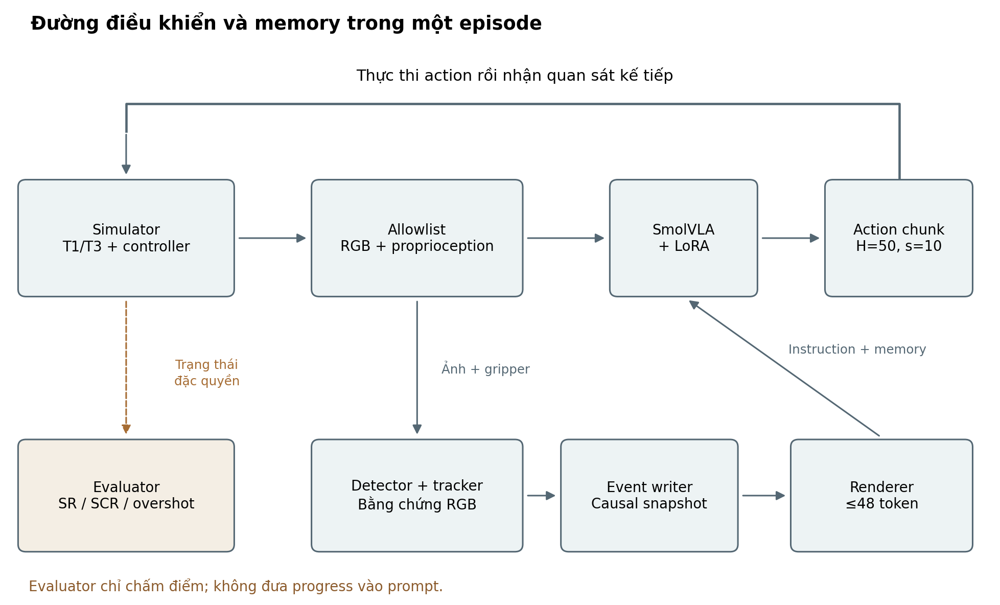
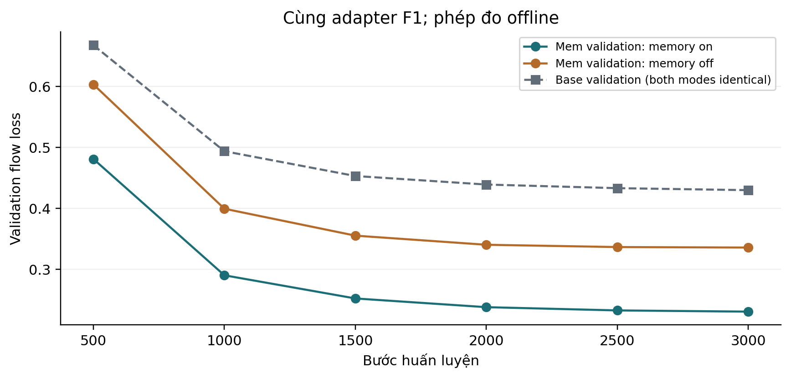
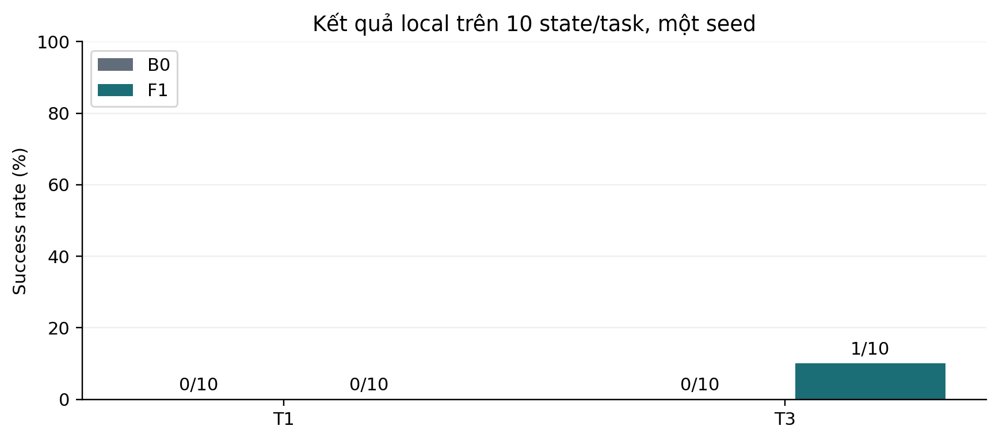

# Tóm tắt

Các tác vụ thao tác lặp đặt ra một khó khăn cho mô hình thị giác–ngôn ngữ–hành động: trạng thái quan sát gần giống nhau có thể đòi hỏi hành động khác nhau tùy theo những sự kiện đã xảy ra. Khóa luận khảo sát một phương án bổ sung bộ nhớ sự kiện thị giác cho SmolVLA nhằm cung cấp thông tin lịch sử trong quá trình điều khiển robot. Phạm vi thực hiện tập trung vào thao tác nhấc và đặt lại một chiếc bát trên đĩa, một lần hoặc ba lần, trong môi trường phát triển từ LIBERO-Mem.

Phương pháp sử dụng detector thị giác, cơ chế theo dõi vật thể và đĩa gốc, cùng máy trạng thái hữu hạn để ghi nhận các lần rời và quay lại đĩa. Mỗi sự kiện gắn với bằng chứng quan sát và thời điểm có thể sử dụng. Khi thiếu bằng chứng, hệ thống ghi nhận lịch sử chưa đầy đủ thay vì suy đoán số chu kỳ đã xảy ra. Bộ nhớ được biểu diễn thành văn bản trong ngân sách tokenizer của policy. Một adapter LoRA trên action expert được huấn luyện với dữ liệu hỗn hợp gồm thao tác cơ sở và tác vụ memory. Simulator, policy và perception được tổ chức thành các tiến trình tách biệt để kiểm soát phụ thuộc và nguồn thông tin.

Bản thảo tại ngày 11/11/2026 ghi nhận một adapter đã được huấn luyện 3.000 bước và một đợt đánh giá có đủ log cho hai điều kiện B0 và F1. Trên mỗi điều kiện, 20 task-episodes sử dụng chung 10 nhóm trạng thái khởi tạo qua hai task và một policy seed. B0 đạt 0/20 episode thành công, F1 đạt 1/20. Đây là kết quả sơ bộ dưới protocol local, mang nhãn NON-COMPARABLE_OFFICIAL_PAPER. Thiết kế hiện tại chưa tách được tác động của fine-tuning khỏi thông tin memory và chưa đủ để kết luận cải thiện đáng tin cậy. Giá trị hiện có của nghiên cứu là thiết kế bộ nhớ có truy vết, quy trình tích hợp và thích ứng, cùng phân tích thực nghiệm về những điều kiện còn thiếu để đánh giá lợi ích của lịch sử một cách có kiểm soát.

**Từ khóa:** Vision-Language-Action; SmolVLA; bộ nhớ sự kiện; quan sát một phần; thích ứng hạng thấp; đánh giá robot.

# Chương 1. Mở đầu

## 1.1. Bối cảnh nghiên cứu

Mô hình thị giác–ngôn ngữ–hành động, gọi tắt là VLA, kết nối quan sát hình ảnh, chỉ dẫn ngôn ngữ và hành động điều khiển robot trong một policy. Khả năng tái sử dụng biểu diễn đã học từ dữ liệu thị giác và ngôn ngữ làm cho hướng tiếp cận này phù hợp với các tác vụ thao tác được mô tả bằng lời. SmolVLA là một đại diện hướng đến mô hình có chi phí triển khai thấp hơn, sử dụng một backbone thị giác–ngôn ngữ cùng action expert để sinh chuỗi hành động [@smolvla2025]. Tuy nhiên, một policy có thể thực hiện thao tác đơn lẻ vẫn chưa chắc xử lý được nhiệm vụ mà quyết định tiếp theo phụ thuộc vào lịch sử.

Xét yêu cầu nhấc một chiếc bát khỏi đĩa rồi đặt lại đúng ba lần. Sau mỗi lần đặt lại, hình ảnh bát trên đĩa có thể gần giống ban đầu. Nếu chỉ quan sát cảnh hiện tại, hệ thống khó phân biệt đã hoàn thành một, hai hay ba lần. Hành động cần thực hiện vì thế không chỉ phụ thuộc vị trí hiện tại của bát mà còn phụ thuộc những lần tương tác trước đó. Ví dụ này cũng chỉ ra rằng chiều dài trajectory và mức cần thiết của memory là hai thuộc tính khác nhau: một nhiệm vụ dài có thể bộc lộ tiến độ ngay trong cảnh, trong khi một nhiệm vụ lặp ngắn hơn có thể cần lịch sử để phân biệt các tình huống.

Các nghiên cứu gần đây đã khảo sát nhiều biểu diễn memory. MEM phối hợp lịch sử ảnh ngắn với tóm tắt ngôn ngữ dài, còn MemoryVLA lưu và truy xuất các biểu diễn perceptual và cognitive trong một memory bank [@mem2026; @memoryvla2026]. LIBERO-Mem xây dựng các tình huống thao tác có thông tin quan trọng gắn với lịch sử của thực thể [@liberomem2025]. Những công trình này tạo động lực nghiên cứu, đồng thời cho thấy không thể đánh giá memory chỉ bằng việc thêm một chuỗi văn bản vào instruction rồi quan sát một vài rollout.

## 1.2. Bài toán đặt ra

Khóa luận nghiên cứu cách bổ sung một bộ nhớ sự kiện bên ngoài SmolVLA. Bộ nhớ phải được xây dựng từ quan sát được phép sử dụng, giữ thông tin có ích qua thời gian và tạo đầu vào phù hợp cho policy. Hai yêu cầu cần được giải quyết đồng thời là tính đúng đắn của thông tin được ghi và khả năng policy khai thác thông tin đó. Một hệ thống ghi nhiều sự kiện nhưng thường nhầm lẫn không đương nhiên tốt hơn hệ thống có khả năng từ chối xác nhận khi thiếu bằng chứng.

Trong phạm vi hiện tại, bài toán được thu hẹp vào quan hệ giữa một chiếc bát và đĩa gốc của nó. Hệ thống theo dõi các lần bát rời đĩa và quay lại. T1 yêu cầu một lần nhấc–đặt lại; T3 yêu cầu ba lần. Đây là tập con của hướng nghiên cứu về thao tác có lịch sử thực thể, chưa đại diện cho memory nhiều vật thể, quan hệ chứa, thứ tự tương tác phức tạp hoặc chuyển giao sang robot thật.

Một khó khăn độc lập với thiết kế memory là tính hợp lệ của phép đo. Policy, simulator, dữ liệu demonstration, bộ tiền xử lý và bộ chấm điểm phải có nguồn gốc rõ ràng. Nếu quy ước ảnh hoặc điều kiện kết thúc khác nhau, chênh lệch success có thể phản ánh thay đổi của đường thực nghiệm thay vì thông tin lịch sử. Vì vậy, xây dựng một phép so sánh có thể kiểm tra lại là một phần của phương pháp nghiên cứu.

## 1.3. Mục tiêu và câu hỏi nghiên cứu

Mục tiêu tổng quát là khảo sát khả năng hỗ trợ tác vụ chuỗi dài của VLA bằng bộ nhớ sự kiện thị giác. Mục tiêu thực hiện ở giai đoạn này gồm thiết kế bộ nhớ, tích hợp với checkpoint có nguồn gốc xác định, huấn luyện thích ứng nhẹ và thực hiện đánh giá sơ bộ trong mô phỏng.

RQ1 đặt câu hỏi liệu có thể đưa memory từ RGB vào SmolVLA trong khi duy trì ranh giới thông tin và contract của policy. RQ2 xem xét liệu lịch sử giúp xử lý tác vụ lặp tốt hơn khi đã kiểm soát tác động của adaptation. RQ3 kiểm tra khả năng duy trì kỹ năng cơ sở sau thích ứng. RQ4 tìm hiểu những giới hạn do chất lượng writer, quy ước dữ liệu và chi phí thực thi gây ra. Các câu hỏi được tách ra để một bằng chứng về khả năng vận hành không bị diễn giải thành bằng chứng về hiệu quả hay tính tổng quát.

## 1.4. Phạm vi và đóng góp

Nghiên cứu sử dụng nguồn task và simulator từ LIBERO cùng nhánh LIBERO-Mem đã được khóa revision [@liberoSource; @liberomemSource]. Giai đoạn V1 thiết lập baseline policy không memory. Phần memory thuộc V2; các kết quả hai giai đoạn không được gộp khi runtime hoặc cadence thực thi khác nhau. Mọi kết quả local trong bản thảo được phân loại là LIBERO-derived và không so ngang với điểm của paper chính thức.

Đóng góp hiện có thứ nhất là một thiết kế tích hợp bộ nhớ sự kiện có bằng chứng và thời điểm khả dụng, gắn với quy tắc xử lý lịch sử chưa đầy đủ. Thứ hai là quy trình nối bộ nhớ với SmolVLA bằng văn bản và thích ứng action expert, có lưu provenance của dữ liệu, tokenizer và adapter. Thứ ba là tập artifact thực nghiệm và cách phân tích giúp phân biệt tiến độ triển khai với mức độ kiểm chứng giả thuyết. Những thành quả này có ý nghĩa ở phương diện thiết kế hệ thống nghiên cứu và thực hành thực nghiệm.

Khóa luận kế thừa SmolVLA, Grounding DINO, LoRA, loss huấn luyện và các tài nguyên benchmark. Việc kết hợp chúng không tự chứng minh một nguyên lý memory mới hoặc hiệu năng vượt các công trình liên quan. Đóng góp về cải thiện policy chỉ được xác nhận khi có đối chứng phù hợp. Ở tiến độ hiện tại, kết luận đó vẫn còn mở.

## 1.5. Bố cục khóa luận

Chương 2 trình bày những khái niệm cần thiết và định vị phương pháp trong các nghiên cứu về memory cho robot. Chương 3 mô tả bộ nhớ sự kiện, giao diện policy, dữ liệu thích ứng và protocol đánh giá. Chương 4 trình bày các thí nghiệm có artifact kiểm tra được, phân tích kết quả và chỉ rõ phần chưa đủ bằng chứng. Chương 5 rút ra kết luận ở phạm vi hiện tại và xác định các bước nghiên cứu tiếp theo.

# Chương 2. Cơ sở lý thuyết và nghiên cứu liên quan

## 2.1. VLA và quyết định dưới quan sát một phần

Gọi $x_t$ là trạng thái đầy đủ của môi trường tại thời điểm $t$, $o_t$ là quan sát và $a_t$ là hành động. Trong mô phỏng, $x_t$ có thể bao gồm vị trí, vận tốc, tiếp xúc và các biến của bộ đánh giá. Tuy nhiên, policy không được quyền sử dụng tất cả các biến đó. Đầu vào của policy chỉ gồm những kênh được khai báo, chẳng hạn ảnh camera và proprioception của robot. Sự phân biệt này quan trọng vì dùng biến tiến độ từ evaluator làm memory sẽ thay đổi bản chất bài toán.

Lịch sử quan sát–hành động có thể viết thành $h_t=(o_0,a_0,\ldots,a_{t-1},o_t)$. Một biểu diễn memory $m_t$ được xem là phép nén có chọn lọc của lịch sử đó. Memory có ích nếu giữ thông tin cần cho quyết định mà quan sát hiện tại không biểu đạt đầy đủ. Khóa luận không giả định rằng một bộ đếm chu kỳ là sufficient statistic cho toàn bộ trạng thái môi trường; nó chỉ là biểu diễn chuyên biệt cho tác vụ đang xét.

Hai lịch sử có thể dẫn đến các quan sát gần nhau nhưng đòi hỏi quyết định khác nhau. Trường hợp bát đã quay về đĩa hai lần và ba lần là một ví dụ về thiết kế task như vậy. Dù vậy, sự giống nhau bằng mắt không phải chứng minh hai phân phối quan sát hoàn toàn đồng nhất. Các tín hiệu phụ như tư thế robot hay thời gian có thể tương quan với tiến độ. Một đánh giá memory chặt chẽ cần xem xét khả năng policy sử dụng những tín hiệu đó.

## 2.2. SmolVLA và thực thi theo action chunk

Trong hệ thống này, policy sinh một ma trận hành động $A_t$ gồm $H$ hàng. Mỗi hàng là lệnh điều khiển tại một bước. Bộ điều khiển chỉ thực thi $s$ hành động đầu, nhận quan sát mới rồi yêu cầu policy dự đoán lại. Vì vậy, $H$ là độ dài dự đoán và $s$ là khoảng thực thi giữa hai lần lập kế hoạch lại. Chúng không phải cùng một đại lượng.

Checkpoint được sử dụng là `lerobot/smolvla_libero` tại revision đã pin [@smolvlaCheckpoint]. Contract local xác định $H=50$, action có bảy chiều và state đầu vào có tám chiều. State gồm vị trí end-effector, biểu diễn quay axis-angle và hai vị trí khớp gripper. Hai camera là `agentview` và `robot0_eye_in_hand`. Những lựa chọn này xuất phát từ checkpoint và processor đang sử dụng, không phải giả định áp dụng cho mọi VLA.

Quy trình tiền xử lý và giải chuẩn hóa hành động do implementation LeRobot tương ứng thực hiện. Adapter của khóa luận giữ nhiệm vụ ánh xạ dữ liệu và kiểm tra contract. Đối với checkpoint này, gripper đi theo dấu native của simulator: giá trị âm mở, giá trị dương đóng. Không được sao chép quy ước dấu của một checkpoint khác chỉ vì các model cùng điều khiển Panda.

Trong thí nghiệm Mem, $s=10$ dù $H=50$. Ở tần số điều khiển mô phỏng20 Hz, mười action tương ứng nửa giây thời gian mô phỏng. Điều này không có nghĩa toàn hệ thống xử lý trong nửa giây thời gian thực: simulator có thể tạm dừng khi chờ suy luận và perception. Phân biệt này cần được giữ khi trình bày latency và khả năng triển khai.

## 2.3. Các hướng biểu diễn memory

Lịch sử ảnh giữ nhiều thông tin về hình học và động học nhưng tăng chi phí xử lý. Memory đặc trưng nén thông tin vào vector có thể học được; memory ngôn ngữ hoặc sự kiện tạo biểu diễn dễ kiểm tra nhưng có thể mất chi tiết cần cho thao tác. Không có biểu diễn nào mặc nhiên phù hợp với mọi thang thời gian và mọi tác vụ.

MEM phối hợp short-term video memory với long-term language memory. Video encoder nén nhiều quan sát trước khi đưa vào backbone; một policy cấp cao cập nhật bản tóm tắt ngữ nghĩa và chỉ dẫn subtask. Cơ chế nén ngôn ngữ giúp giảm việc mang theo chuỗi instruction lặp lại không còn cần thiết. Thiết kế này gợi ý rằng nên phân biệt sự kiện đã xảy ra với lệnh từng được phát ra [@mem2026].

MemoryVLA sử dụng Perceptual–Cognitive Memory Bank. Quan sát hiện tại tạo truy vấn để lấy ngữ cảnh lịch sử; thông tin được kết hợp bằng gate và hợp nhất khi vượt dung lượng. Memory ở đây nằm trong không gian đặc trưng và được tích hợp vào action expert, khác với giao diện văn bản tường minh của khóa luận. Các ablation về loại memory, chiều dài, retrieval, fusion và consolidation là ví dụ về cách đánh giá từng thành phần thay vì chỉ báo điểm của toàn hệ thống [@memoryvla2026].

LIBERO-Mem nhấn mạnh lịch sử theo thực thể; paper đi kèm khảo sát một hướng slot-centric có mô hình trạng thái theo thời gian. Bộ nhớ của khóa luận không tái hiện kiến trúc này. Nghiên cứu chỉ kế thừa task và động lực cần thông tin lịch sử, sau đó chọn một cơ chế sự kiện nhỏ hơn để khảo sát trên SmolVLA [@liberomem2025].

| Hướng | Thông tin lưu | Cách dùng lịch sử | Liên hệ với khóa luận |
|---|---|---|---|
| MEM | Video ngắn và tóm tắt ngôn ngữ | Policy nhiều cấp | Động lực phân biệt thang thời gian và nén sự kiện |
| MemoryVLA | Đặc trưng perceptual/cognitive | Retrieval, gate, consolidation | Tham khảo thiết kế ablation |
| LIBERO-Mem/Embodied-SlotSSM | Biểu diễn thực thể theo thời gian | Slot-state-space và relational encoding | Nguồn task và bài toán lịch sử thực thể |
| Phương pháp của khóa luận | Sự kiện bát–đĩa, count và cờ thiếu lịch sử | Renderer văn bản và action-expert adapter | Thiết kế tường minh, phạm vi hẹp, cần kiểm chứng riêng |

Bảng trên so sánh lựa chọn thiết kế, không phải xếp hạng hiệu năng. Các paper dùng model, dữ liệu, robot và protocol khác với hệ thống local.

## 2.4. Từ detection đến sự kiện

Grounding DINO là detector nhận mô tả ngôn ngữ và ảnh để xác định đối tượng [@groundingdino2024]. Trong khóa luận, nó là nguồn bounding box cho bát và đĩa. Bounding box là bằng chứng thị giác, không trực tiếp là contact vật lý hay chứng nhận vật đã được đặt đúng. Do đó cần một tầng theo dõi và diễn giải theo thời gian.

Tracker giải quyết câu hỏi đối tượng hiện tại có tương ứng với thực thể được theo dõi trước đó hay không. Trong cảnh có nhiều proposal hoặc bị che khuất, hệ thống cần cho phép trạng thái không xác định. Writer tiếp nhận các tín hiệu đã qua tracker và xác nhận sự kiện khi một cấu hình chuyển trạng thái được quan sát đủ bền vững. Hysteresis yêu cầu có departure mới trước khi ghi nhận return mới; nhiều frame bát nằm yên trên đĩa không được tính thành nhiều chu kỳ.

Điểm detector và các ngưỡng hình học là tham số của estimator. Chúng chưa phải xác suất đã hiệu chỉnh rằng sự kiện đúng. Khi đánh giá writer, cần đối chiếu event với nhãn độc lập theo một quy tắc ghép thời gian đặt trước. Tỷ lệ có suffix memory trong prompt chỉ đo việc cung cấp văn bản, không đo tính đúng đắn của nội dung.

## 2.5. LoRA, mục tiêu huấn luyện và replay

LoRA bổ sung một cập nhật hạng thấp vào ma trận trọng số đã có. Với $W_0$ là trọng số gốc, có thể viết [@lora2021]:

$$
W = W_0 + \frac{\alpha}{r}BA.
$$

Ở đây $A$ và $B$ là các ma trận được học, $r$ là hạng và $\alpha$ là hệ số scale. Trọng số nền có thể giữ cố định trong khi tối ưu cập nhật nhỏ hơn. Trong artifact của khóa luận, LoRA tác động vào các phép chiếu query/value thuộc attention của action expert. Đây là lựa chọn thích ứng của hệ thống, không phải một thuật toán LoRA mới.

Flow matching huấn luyện một trường vector theo một đường biến đổi có điều kiện giữa nhiễu và dữ liệu [@flowmatching2023]. Bản thảo sử dụng ký hiệu tổng quát để mô tả mục tiêu:

$$
\mathcal{L}_{\mathrm{FM}} = \mathbb{E}_{\tau,A,\epsilon}\left[\left\|v_{\theta}(A_{\tau},\tau,c)-u_{\tau}(A,\epsilon)\right\|_2^2\right].
$$

$c$ chứa các điều kiện quan sát, instruction và memory được phép sử dụng. Công thức nêu vai trò của loss; quá trình huấn luyện thực tế gọi loss của implementation SmolVLA đã pin, không tự thay sampling, masking hay normalizer. Loss trên dữ liệu offline đánh giá dự đoán action ở phân phối đã lưu. Success trong closed loop còn phụ thuộc những trạng thái policy tự tạo ra, nên loss nhỏ hơn không tự suy ra tỷ lệ hoàn thành cao hơn.

Replay trộn dữ liệu thao tác cơ sở với dữ liệu Mem nhằm duy trì tiếp xúc với các kỹ năng ban đầu trong quá trình thích ứng. Recipe hiện dùng phân bổ 50/50 theo domain. Đây là tham số thực nghiệm cần kiểm tra retention, không phải một bảo đảm chống quên.

Một vấn đề liên quan rộng hơn là phân phối kinh nghiệm huấn luyện. SGS trong *A Balanced Data Diet* ưu tiên các cấu hình có mức success trung gian trong RL quy mô lớn [@balanceddiet2026]. Khóa luận không dùng SGS: bộ lấy mẫu của hệ thống là replay có phân tầng domain/task/episode cho SFT. Liên hệ giữa hai hướng nằm ở yêu cầu mô tả phân phối dữ liệu và ngân sách khi so sánh, không ở sự đồng nhất về thuật toán.

## 2.6. Benchmark, metric và đơn vị thống kê

LIBERO cung cấp task, assets và demonstration để nghiên cứu robot learning [@libero2023]. Việc sử dụng tài nguyên chính thức không tự làm mọi cấu hình thực thi trở thành phép tái hiện điểm chính thức. Nếu thay runtime, reset, horizon hoặc điều kiện kết thúc, nghiên cứu phải ghi rõ phạm vi và nhãn so sánh.

Tỷ lệ thành công đo số episode đạt điều kiện cuối. Subgoal Completion Rate, viết tắt SCR, đo phần milestones đã đạt. Overshot phản ánh việc thực hiện dư theo semantics của evaluator. Các đại lượng này bổ sung cho nhau: một episode có thể hoàn thành các milestones nhưng vẫn thất bại vì tiếp tục thực hiện dư chu kỳ.

Đơn vị thống kê cũng phải được xác định. Nhiều frame trong một episode không phải nhiều episode độc lập; hai task dùng chung một trạng thái khởi tạo cũng có thể phụ thuộc. Phép so sánh giữa conditions cần ghép theo task, initial-state hash và policy seed. Khi tổng hợp hai task chung state, uncertainty nên được ước lượng theo nhóm state, giữ các cặp và những lần lặp liên quan trong cùng nhóm. Không sử dụng số lượng frame hay action để làm tăng giả tạo kích thước mẫu.

# Chương 3. Bộ nhớ sự kiện thị giác cho SmolVLA

## 3.1. Phát biểu bài toán và giả định

Tại bước $t$, hệ thống nhận hai ảnh RGB và trạng thái robot. Đặt $o_t=(I_t^{\mathrm{ext}},I_t^{\mathrm{wrist}},p_t)$, trong đó $p_t\in\mathbb{R}^{8}$. Instruction $\ell$ mô tả task. Bộ nhớ sự kiện được cập nhật theo lịch sử khả dụng:

$$
\begin{aligned}
m_t&=U(m_{t-1},o_t,a_{t-1}),\\
c_t&=R(\ell,m_t),\qquad A_t\sim\pi_{\theta,\phi}(\cdot\mid o_t,c_t).
\end{aligned}
$$

$U$ là writer, $R$ là renderer, $\theta$ biểu diễn checkpoint gốc và $\phi$ là các tham số thích ứng. Tại bước khởi tạo không có action trước đó; writer chỉ đọc quan sát đầu. Từ các bước sau, action đi vào writer phải là action đã thực thi, không phải action còn nằm trong chunk dự đoán. Memory không được chứa ảnh tương lai, nhãn success cuối episode hoặc biến đếm của evaluator.

Trong T1/T3, mục tiêu thị giác là bát được xác định trong vùng cảnh ban đầu cùng đĩa nâng đỡ nó. Khi bằng chứng không đủ để gán danh tính hoặc xác nhận quan hệ, trạng thái phải giữ chưa biết. Giả định quan trọng là quan hệ nâng và đặt lại có thể được ước lượng từ các biến đổi bounding box và trạng thái mở gripper dưới góc nhìn đang dùng. Đây là giả định của estimator 2D, cần được kiểm chứng; nó không thay thế mô phỏng tiếp xúc 3D.

## 3.2. Kiến trúc và ranh giới thông tin

Hệ thống có ba đường xử lý liên quan nhưng khác chức năng. Đường điều khiển nhận quan sát, dựng prompt và sinh action. Đường bộ nhớ chuyển ảnh thành bằng chứng, cập nhật trạng thái sự kiện và tạo snapshot. Đường đánh giá đọc trạng thái simulator để chấm điểm. Chỉ kết quả từ hai đường đầu được đưa vào policy; thông tin đánh giá được lưu để phân tích sau.



Simulator chạy trong process có dependency riêng; detector cũng có process riêng. Policy giao tiếp với simulator bằng request/response có identity và thứ tự bước. Các kênh quan sát được allowlist, còn lỗi worker, timeout hoặc sai contract phải được báo rõ. Việc tách process làm giảm xung đột thư viện nhưng không tự chứng minh tính tương đương của runtime. Manifest của từng run vẫn cần ghi môi trường thực sự đã sử dụng.

Đối với đường F1 hiện tại, writer giữ trạng thái episode và trả snapshot cho renderer. Repository còn có các abstraction store/updater/retriever cho những thiết kế memory trước; sự tồn tại của các lớp này không có nghĩa tất cả đều nằm trên đường thực thi của F1. Mô tả kiến trúc ở đây bám vào đường `LiberoMemRolloutRunner`, visual writer và renderer đã được sử dụng.

## 3.3. Theo dõi bát và đĩa gốc

Detector được pin theo model/revision và cấu hình truy vấn. Tracker không được tự lấy nhãn đối tượng, reward hay subgoal từ simulator làm detection. Bằng chứng gồm bounding box, camera, bước quan sát và hash của frame; thông tin này cho phép phát hiện việc dùng nhầm frame hoặc cache không khớp.

Đĩa gốc được xác lập từ quan sát ban đầu khi quan hệ bát–đĩa đủ rõ và gripper đã mở. Những lần sau, tracker tìm proposal phù hợp với anchor đó, không chọn bất kỳ đĩa nào đang gần bát nhất. Cách gắn anchor giúp diễn đạt đúng yêu cầu “đặt lại đĩa ban đầu”, nhưng chỉ phù hợp với phạm vi cảnh mà các giả định theo dõi còn đúng.

Gọi $b_t$ và $q_t$ là tọa độ tâm mép dưới bounding box của bát và đĩa ở frame hiện tại; $b_0,q_0$ là các tọa độ tại lúc xác lập anchor, và $w_0,h_0$ là kích thước bát ban đầu. Tracker xét biến đổi tương đối:

$$
d_t=(b_t-q_t)-(b_0-q_0),\qquad D_t=\left\|d_t\oslash(w_0,h_0)\right\|_2,\qquad L_t=-d_{t,y}/h_0.
$$

$\oslash$ biểu thị phép chia theo từng thành phần. $D_t$ mô tả độ lệch khỏi cấu hình tương đối ban đầu, còn $L_t$ là tín hiệu nâng theo chiều ảnh. Implementation kết hợp các đại lượng này với ràng buộc scale, mức chuyển động giữa các frame và khoảng mở gripper. Các ngưỡng là hyperparameter của writer, không phải tham số contact của benchmark.

Khi có nhiều proposal cạnh tranh, tracker sử dụng tính liên tục của vị trí đo trước trong một khoảng thời gian giới hạn. Vị trí cũ chỉ hỗ trợ association; nó không được phát lại như một detection hiện tại nếu không có bằng chứng. Trạng thái ambiguous hoặc missing phải được truyền sang writer. Điều này bảo toàn ý nghĩa “đã quan sát”, dù có thể làm giảm số frame cung cấp count đầy đủ.

## 3.4. Máy trạng thái ghi sự kiện

Writer vận hành qua các trạng thái chưa khởi tạo, đã thấy support, ứng viên departure, departure đã xác nhận, ứng viên return và return đã xác nhận. Việc có các trạng thái ứng viên giúp tránh ghi sự kiện chỉ từ một frame nhiễu. Cấu hình được dùng trong artifact training yêu cầu ba frame phù hợp cho bước xác nhận.

Khi quan sát ban đầu cho thấy bát trên đĩa ổn định và gripper mở, writer ghi `initial_support_observed`. Sau đó, các tín hiệu nâng bền vững tạo `departed_support`. Chỉ khi đã có departure, một chuỗi quan sát quay lại gần đĩa gốc, ổn định và gripper mở mới tạo `returned_to_support` và tăng counter. Sau return, phải xuất hiện một departure mới trước khi có thể tăng counter tiếp.

Thuật toán sau mô tả logic chính; các ngưỡng và kiểm tra danh tính được thực hiện trong tracker, không được thay bằng pseudocode này khi benchmark.

```text
Tại mỗi quan sát o_t theo đúng thứ tự:
    E_t <- phát hiện và liên kết bằng chứng thị giác
    Nếu mất bằng chứng hoặc bỏ qua bước:
        đánh dấu history_complete = False
        xóa ứng viên chưa xác nhận; giữ các sự kiện đã ghi
    Nếu chưa xác lập support:
        xác nhận support ban đầu khi đủ bằng chứng ổn định
    Nếu support đã biết và chưa có departure đang diễn ra:
        xác nhận departure khi tín hiệu nâng đủ bền vững
    Nếu đã có departure:
        xác nhận return khi gần đĩa gốc, ổn định và gripper mở
        tăng count đúng một lần; kết thúc departure hiện hành
    Xuất snapshot có evidence và thời điểm khả dụng
```

Hysteresis làm cho counter không tăng chỉ vì robot đứng yên trên đĩa qua nhiều frame. Tuy nhiên, tính nhất quán của chuyển trạng thái không chứng minh detection đúng. False positive ở perception vẫn có thể dẫn đến event sai. Vì thế, correctness của FSM và fidelity của sự kiện phải được đánh giá bằng các loại bằng chứng khác nhau.

Khi có khoảng quan sát không đủ bằng chứng, writer giữ số return đã xác nhận nhưng đánh dấu lịch sử chưa đầy đủ. Renderer có thể biểu đạt “ít nhất” số return đã ghi hoặc báo count chưa biết. Cách diễn đạt này phản ánh sự thận trọng của estimator; nó chỉ là cận dưới thật nếu các return đã xác nhận đều đúng. Khóa luận chưa có bằng chứng để bảo đảm điều kiện đó cho mọi episode.

## 3.5. Tính nhân quả và giao diện văn bản

Mỗi sự kiện phân biệt `occurred_at` với `available_at`. Nếu tín hiệu bắt đầu ở frame 10 và cần ba frame để xác nhận, sự kiện có thể được quy về frame 10 nhưng chỉ sẵn sàng sau frame 12. Với query tại bước $q$, quy tắc sử dụng là:

$$
t_{\mathrm{occurred}}\le t_{\mathrm{available}}\le q.
$$

Việc gán timestamp ngược về thời điểm bắt đầu không cho phép đưa sự kiện vào các prompt trước khi có đủ bằng chứng. Quy tắc này đặc biệt quan trọng khi xây dựng dữ liệu offline, vì toàn bộ trajectory tương lai đã có trên đĩa nhưng không được phép đi vào sample tại thời điểm hiện tại.

Renderer kiểm tra nguồn của snapshot, event được tham chiếu, danh tính object/support và sự thống nhất giữa count với các return events. Trong đường predicted, dữ liệu có nguồn oracle simulator hoặc human annotation không được dùng để tạo fact cho policy. Snapshot chứa dữ liệu đặc quyền không trở thành nguồn hợp lệ chỉ bằng việc bỏ một trường hiển thị.

Instruction gốc được giữ làm phần đầu của prompt. Renderer chỉ thêm những fact phù hợp với ngân sách của tokenizer thực tế. Ngân sách được đặt là 48 token cho toàn bộ instruction cộng memory, kể cả quy ước newline và special tokens được áp dụng. Nếu chỉ instruction đã vượt budget, runner dừng thay vì âm thầm cắt nội dung. Nếu memory không đủ chỗ, fact bị loại được ghi trong telemetry.

Một ví dụ khái niệm là instruction yêu cầu ba lần nhấc–đặt lại, đi kèm suffix nói rằng writer đã quan sát hai lần quay về đĩa gốc. Ví dụ này minh họa giao diện; nó không phải bằng chứng rằng policy hiểu suffix hoặc sẽ dừng đúng sau lần thứ ba. Bằng chứng sử dụng hữu ích phải đến từ thí nghiệm có đối chứng.

## 3.6. Dữ liệu, quy ước ảnh và khóa split

Dữ liệu thích ứng hiện tại ghép demonstration LIBERO-10 với T1/T3 từ bản phát hành của tác giả. Các episode được gán vào train/validation/test theo nhóm trạng thái khởi tạo. Hash được tính trên toàn bộ vector state đã chuẩn hóa về biểu diễn float64 little-endian, nhờ đó các episode có cùng vector không bị tách sang hai split chỉ vì mang task hoặc demo ID khác nhau.

Nhóm state đã dùng phát triển writer phải ở train. Cơ chế grouping làm giảm một loại leakage cụ thể; nó không loại bỏ việc tác giả quan sát test để sửa hệ thống, cũng không chứng minh checkpoint pretrained chưa từng thấy các task hoặc state tương tự. Vì vậy, provenance của split và lịch sử sử dụng dữ liệu cần được báo riêng.

Quy ước ảnh là một phần của contract dữ liệu. Frame author-refined của Mem và ảnh raw OpenGL từ simulator không được xử lý như cùng nguồn. Đường preparation hiện xác định convention từ source: ảnh refined được đưa về raw đúng một lần, còn ảnh replay derived vốn là raw được giữ nguyên trước processor policy. Writer cũng phải nhận convention tương ứng ở offline và online. Việc một HDF5 có shape hợp lệ chưa chứng minh hình ảnh đi vào model đúng hướng.

Đường dữ liệu derived mới nhằm tạo lại observation từ chính runtime local. Action replay chỉ được chấp nhận làm demonstration nếu outcome mới đáp ứng quy tắc chất lượng đã đặt trước. Không thể lấy nhãn memory của trajectory cũ gắn vào ảnh mới sau khi động lực học đã khác. Generator, kiểm tra terminal, resume, source hash và publication của manifest vì thế thuộc chuỗi nghiệm thu dữ liệu. Ở mốc bản thảo, source cho chuỗi này đã được bổ sung nhưng output version mới chưa hoàn tất; checkpoint được báo cáo ở chương 4 vẫn dùng dữ liệu tác giả.

## 3.7. Thích ứng action expert

Hệ thống giữ checkpoint SmolVLA gốc và huấn luyện adapter LoRA ở attention query/value của action expert. Các normalizer và cách giải mã action vẫn thuộc checkpoint gốc. Việc export adapter riêng giúp phân biệt trọng số nền với thay đổi do thích ứng và cho phép kiểm hash từng thành phần khi nạp lại.

Bộ lấy mẫu chia một optimizer batch giữa base và Mem, sau đó cân bằng task và chọn episode trong từng domain. Việc chọn frame theo episode giúp trajectory dài không tự chiếm toàn bộ xác suất chỉ vì có nhiều frame hơn. Training dùng loss chính thức cùng padding/mask tương ứng, thay vì tự dựng một mục tiêu action khác.

Trong thiết kế đối chứng, F0 phải được huấn luyện trên cùng demonstration, split và ngân sách nhưng không có memory. F1 dùng memory trong quá trình thích ứng và suy luận. B0 giữ policy gốc. F1-off dùng cùng adapter F1 nhưng bỏ memory khi suy luận. B0–F0 mô tả adaptation; F0–F1 giúp đánh giá hệ thống memory khi adaptation budget được kiểm soát; F1–F1-off đo độ phụ thuộc vào đầu vào memory của cùng checkpoint. Phép so sánh cuối có thể chịu ảnh hưởng out-of-distribution nếu F1 không từng được train với memory off.

Ngay cả F0–F1 cũng cần được diễn giải cẩn thận. F1 nhận thông tin từ detector ngoài backbone cùng một biểu diễn lịch sử. Muốn tách giá trị lịch sử khỏi phần tóm tắt quan sát hiện tại, cần thêm đối chứng current-only; muốn kiểm tra ảnh hưởng của thêm token cần một đối chứng sham phù hợp ngân sách. Những đối chứng này hiện là thiết kế cần thực hiện, không phải kết quả đã có.

## 3.8. Protocol thực thi và chấm điểm

Protocol local giữ Panda với controller OSC_POSE20 Hz, hai camera 256×256 và initial state từ split lock. Sau reset có 20 bước warmup với action đã khai báo; trạng thái tiến độ được làm sạch theo protocol. Policy sinh chunk 50 nhưng chỉ thực thi10 action trước khi query lại. Trong khoảng đó, writer tiếp nhận từng observation sau action, giúp sự kiện không chỉ được cập nhật ở ranh giới chunk.

Horizon của mỗi episode là 1.000 policy actions. Thiết kế không dừng sớm ngay khi một milestone hoặc full success tạm thời xuất hiện; episode tiếp tục đến horizon, hoặc dừng khi upstream overshot không thể phục hồi. Thành công được xét ở endpoint theo đồng thời ba điều kiện: đủ milestones, final predicate còn đúng và không overshot. Đây là lựa chọn protocol local, không được gắn nhãn điểm chính thức của paper.

Gọi $K_i$ là số milestones đạt, $K_i^*$ là số cần thiết, $P_i$ là final predicate và $O_i$ là cờ overshot. Các độ đo được diễn đạt:

$$
\begin{aligned}
S_i&=\mathbf{1}[K_i\ge K_i^*\land P_i\land\neg O_i],\\
\mathrm{SCR}_i&=\frac{K_i}{K_i^*},\qquad \widehat{\mathrm{SR}}=\frac{1}{N}\sum_{i=1}^{N}S_i.
\end{aligned}
$$

Đối với hai task có cùng số episode, macro-average bằng trung bình gộp theo episode. Nếu số episode khác nhau, cần báo rõ hai kiểu trung bình và không đổi cách tổng hợp sau khi thấy kết quả. Run chưa hoàn tất phải báo coverage, không coi episode còn thiếu là failure hay success.

Evaluator lấy predicate và tiến độ từ implementation upstream đã pin. Các counters live/nonlive tích lũy giữa milestones; protocol ghi điều kiện vượt ngưỡng tương ứng, không phải số frame liên tiếp của writer. Gọi evaluator thêm lần nữa chỉ để logging có thể làm thay đổi tiến độ, nên logging phải đọc kết quả đã tính. Sự độc lập giữa writer và evaluator cho phép so sánh hai nguồn đánh giá mà không tạo vòng rò rỉ thông tin.

## 3.9. Giới hạn của phương pháp hiện tại

Phương pháp được thiết kế cho một quan hệ vật–support và các chu kỳ lặp. Nó chưa có đánh giá đầy đủ về đổi danh tính khi nhiều vật giống nhau, thay đổi camera, occlusion dài hoặc support di chuyển. Memory văn bản mất phần lớn thông tin hình học của lịch sử; policy vẫn phải thực hiện thao tác chính xác từ quan sát hiện tại.

Chi phí perception có thể lớn vì detector được gọi theo observation. Số tham số LoRA nhỏ không đồng nghĩa toàn hệ thống có latency thấp. Mặt khác, bộ nhớ lưu event và evidence trong episode, nên không thể suy rằng chi phí lưu trữ luôn hằng số chỉ vì prompt có 48 token. Các giới hạn này cần được đo thay vì loại bỏ bằng mô tả kiến trúc.

Cuối cùng, các kiểm tra contract không bao phủ mọi nhánh của repository. Chẳng hạn adapter hiện còn một nhánh legacy gán gripper state mặc định nếu thiếu field; chưa có bằng chứng nhánh đó được kích hoạt trong các run được báo cáo, nhưng nó ngăn việc tuyên bố toàn codebase tuyệt đối fail-fast. Bản thảo không sửa hoặc hợp thức hóa nhánh này. Các đường sử dụng trong benchmark phải được audit theo artifact thực tế và yêu cầu dừng khi thiếu quan sát bắt buộc.

# Chương 4. Thực nghiệm và thảo luận

## 4.1. Phạm vi bằng chứng thực nghiệm

Chương này trình bày những artifact đã tồn tại và được rà soát tại ngày 11/11/2026. Việc tổng hợp cho bản thảo không chạy thêm policy, simulator hoặc training. Các số liệu mới được tính lại từ log đã lưu, không phải một đợt benchmark mới. Snapshot, đường dẫn input và SHA-256 được lưu cùng tài liệu để người đọc có thể truy vết [@artifact2026].

Bộ thực nghiệm chính là `step5_test_20261109-093744`, gồm hai thư mục condition B0 và F1. Mỗi condition có 20 episode complete, chia đều cho T1 và T3. Từng `summary.json` được đối chiếu checksum đã ghi trong `status.json`; roster task/state/seed cũng được kiểm tra. Phép kiểm này xác nhận tính nhất quán của các artifact được dùng trong bảng, không chứng nhận lại mọi byte của simulator, video hoặc dữ liệu huấn luyện.

Báo cáo freeze V1 vẫn là nguồn lịch sử về giai đoạn không memory. Tuy nhiên, thư mục raw mà báo cáo đó tham chiếu không có episode tại lần rà soát này. Các run khác có tên tương tự không được dùng thay thế. Do đó, chương không sử dụng điểm V1 từ báo cáo cũ làm bảng baseline chính đã xác minh lại. Việc giữ ranh giới này tránh biến một báo cáo tổng hợp thành bằng chứng mạnh hơn những gì còn có thể kiểm tra.

Ngoài bộ Mem chính, repository còn nhiều baseline và fine-tune runs. Công cụ tài liệu đã đọc 1.520 `episode.json` và lập inventory riêng theo run. Inventory phục vụ kiểm kê tiến độ, không xác nhận mọi run đầy đủ hay so sánh được với nhau. Chẳng hạn việc tồn tại một checkpoint được gọi là no-memory không đủ để nhận nó làm F0 matched nếu nguồn dữ liệu và ngân sách khác F1 hiện tại.

## 4.2. Môi trường và provenance

Training run ghi nhận hai GPU Tesla T4. Evaluation run ghi nhận GPU NVIDIA GeForce RTX 4060 Laptop. Simulator evaluation chạy qua WSL trong environment riêng, còn policy dùng Python host Windows và detector dùng một environment Windows riêng. Các thông tin này lấy từ manifest từng run, không lấy giá trị mặc định trong file environment để thay cho runtime đã xảy ra.

| Thành phần | Phiên bản hoặc lựa chọn được ghi nhận |
|---|---|
| Checkpoint gốc | `lerobot/smolvla_libero`, revision `31d453f7edd78c839a8bbc39744a292686daf0de` |
| Nguồn Mem | `libero-mem/libero-mem`, revision `0eee0defa4024e51511b6e15a79f30e9620209de` |
| Simulator | Python 3.8.20, robosuite 1.4.0, MuJoCo 3.2.3, NumPy 1.22.4 |
| Policy evaluation | Python 3.12.2, torch 2.6.0+cu124, LeRobot 0.6.1, transformers 5.5.4, PEFT 0.19.1 |
| Training | torch 2.11.0+cu130, LeRobot 0.6.1, transformers 5.5.4, PEFT 0.21.2, accelerate 1.15.0 |
| Observation | Hai camera 256×256; state 8D; preprocessing theo checkpoint |
| Control | OSC_POSE,20 Hz; chunk 50; execution horizon 10 |
| Reset và endpoint | State từ split lock; warmup 20; horizon 1.000; dừng sớm khi overshot |

Các bản Python hoặc thư viện khác giữa training, policy và simulator được ghi tường minh. Chúng không tạo thành một stack tái hiện nguyên trạng môi trường tham chiếu Python 3.8.13 của V1. Bởi vậy, các kết quả ở đây được sử dụng cho đánh giá nội bộ dưới cấu hình đã khai báo.

Hai manifest B0/F1 có cùng protocol hash, split hash và base checkpoint identity. Source snapshots khác nhau ở ba script launcher/diagnostic; danh sách và hashes nằm trong phụ lục evidence. Không diễn đạt cặp run là toàn bộ mã nguồn giống hệt nhau. Đối với các đường policy/simulator/processor quan trọng, audit và manifests cung cấp căn cứ đối chiếu, nhưng vẫn cần công bố những khác biệt thay vì chỉ ghi một Git commit chung.

## 4.3. Dữ liệu và cấu hình thích ứng

Dataset manifest của training chứa 698 demonstration: 500 thuộc 10 task LIBERO-10 và 198 thuộc Mem T1/T3. Split có 558 train, 70 validation và 70 test. Các con số là số episode được manifest liệt kê, không phải số frame độc lập. Manifest hash khớp identity mà training run ghi lại.

| Nhóm dữ liệu | Train | Validation | Test | Tổng |
|---|---:|---:|---:|---:|
| Base LIBERO-10 | 400 | 50 | 50 | 500 |
| Mem T1 | 80 | 10 | 10 | 100 |
| Mem T3 | 78 | 10 | 10 | 98 |
| Tổng | 558 | 70 | 70 | 698 |

T1/T3 chia sẻ 10 initial-state hashes trong test. Vì vậy,20 task-episodes của một condition chỉ có 10 nhóm state khác nhau. Cách chia split giữ các state trùng nhau trong cùng một tập, nhưng test hiện tại đã được quan sát phục vụ phát triển. Bản thảo gọi đây là kết quả trên split mang tên test trong artifact, không coi nó là holdout xác nhận chưa từng được sử dụng để đưa ra quyết định.

Artifact F1 là adapter unmerged từ run `mem-adapter-20261105-083543`. Run hoàn tất 3.000 bước, rank LoRA 16, 645.120 tham số được train, learning rate khởi đầu $2\times10^{-5}$ và effective batch 32. Cấu hình có base fraction 0,5, memory dropout 0 và checkpoint/validation mỗi 500 bước. Những giá trị này là recipe đã chạy, chưa được chứng minh tối ưu.

Bốn file export được manifest liệt kê đã được hash lại và khớp, gồm trọng số adapter, config, tokenizer và README. Dataset manifest cũng khớp hash training. Lần rà soát không hash lại toàn bộ base weights, raw HDF5 và shards lớn. Không được mở rộng kết quả kiểm bốn file thành khẳng định mọi tài nguyên đều đã được chứng nhận đầy đủ.

Nguồn Mem của F1 là dữ liệu tác giả có convention refined được chuyển về raw trước xử lý policy. Một số replay artifacts derived đời cũ đã được tạo; summary T3 ghi 78 replay và 73 outcome success. Đây là metadata tạo dữ liệu, không phải success rate của policy và chưa là chứng nhận dataset version mới. Tại snapshot, chưa có chuỗi derived-v1 lock/index/shards/training hoàn chỉnh. Vì vậy, F1 trong chương này không phải model đã thích ứng trên dataset derived mới.

## 4.4. Kết quả offline của adapter

Tại step 3.000, loss trên Mem validation của cùng adapter là 0,23023575 khi có memory và 0,33553660 khi bỏ memory. Loss trên base là 0,42984212 ở cả hai mode. Bộ Mem validation chứa 4.299 frame-samples và base validation chứa 13.525 frame-samples. Phép đo này so hai chế độ đầu vào của cùng F1, không phải hai model F0/F1 được train độc lập.



Kết quả cho thấy đầu vào memory liên quan đến loss dự đoán action trong phân phối validation đã lưu. Tuy nhiên, loss nhỏ hơn chưa chứng minh nội dung lịch sử là nguyên nhân của cải thiện closed-loop. Một policy có thể khớp demonstration hơn nhưng vẫn gặp failure khi trajectory của nó rời phân phối demonstration. Cũng chưa có căn cứ gọi step 3.000 là checkpoint tốt nhất theo success, vì chọn checkpoint cuối và chọn theo metric triển khai là hai quy tắc khác nhau.

Base loss giống nhau giữa memory-on/off không chứng minh retention. Nếu base samples không có memory suffix, hai mode có thể tạo cùng đầu vào. Muốn đo retention phải so chính policy đã thích ứng với B0 trong rollout base matched, không so hai lần tính loss của cùng model rồi kết luận kỹ năng được bảo toàn.

## 4.5. Kết quả closed-loop sơ bộ

Bảng dưới được tính trực tiếp từ 40 summary episode hoàn tất. Mỗi condition dùng 20 task-episodes, policy seed 42 và cùng roster trạng thái. Tất cả mang nhãn CUSTOM_V2_LIBERO_MEM và NON-COMPARABLE_OFFICIAL_PAPER.

| Task | Condition | Success / N | SR | Mean SCR | Overshot / N |
|---|---|---:|---:|---:|---:|
| T1 | B0 | 0/10 | 0% | 0,1000 | 1/10 |
| T1 | F1 | 0/10 | 0% | 0,1000 | 1/10 |
| T3 | B0 | 0/10 | 0% | 0,0000 | 0/10 |
| T3 | F1 | 1/10 | 10% | 0,1667 | 0/10 |
| Hai task | B0 | 0/20 | 0% | 0,0500 | 1/20 |
| Hai task | F1 | 1/20 | 5% | 0,1333 | 1/20 |



Quan sát trực tiếp là F1 có thêm một episode thành công trên T3. Phần lớn episode ở cả hai điều kiện vẫn thất bại. Chênh lệch macro 5 điểm phần trăm là mô tả trên bộ mẫu này; nó không đủ xác nhận một cải thiện đáng tin cậy, càng không tách được memory khỏi adaptation và perception.

SCR cung cấp một góc nhìn khác. Trên T1, cả hai conditions đều có một episode đạt milestone nhưng bị overshot nên không thành công ở endpoint. Trên T3, mean SCR của F1 cao hơn B0, cho thấy có một số tiến độ được evaluator ghi nhận. Điều đó vẫn chưa xác định thành phần nào tạo ra khác biệt, và không có lý do để thay metric success bằng SCR chỉ vì SCR thuận lợi hơn.

## 4.6. Phân tích trace và các trường hợp điển hình

Để tránh lựa chọn ví dụ chỉ theo cảm tính, phần này xem episode thành công duy nhất và các episode có overshot. Phân tích dựa trên summary và memory/prompt trace; chưa thay thế một audit toàn bộ video hoặc annotation sự kiện độc lập.

Trong 20 F1 episodes,19 snapshot cuối có cờ lịch sử chưa đầy đủ. Có 1.927 policy queries, trong đó 1.894 prompt chứa suffix memory và 1.738 prompt chứa chuỗi `history incomplete`. Các số này cho thấy renderer thường cung cấp một phát biểu về sự không đầy đủ của lịch sử. Chúng không đo event precision/recall và không phải hàng nghìn phép thử độc lập.

Episode `T3_F1_test_state2`, khởi tạo từ `demo_29`, là success duy nhất. Evaluator ghi nhận ba chu kỳ, final predicate thỏa mãn và không overshot ở horizon 1.000. Trong snapshot cuối của writer, số return được xác nhận là hai và `history_complete=False`. Do đó, success này không thể được mô tả là minh chứng writer đã đếm đúng ba rồi policy dừng theo count đó. Có thể có nhiều cơ chế dẫn đến outcome; trace hiện chưa cho phép xác định cơ chế nhân quả.

Ở `T1_F1_test_state7`, evaluator ghi một milestone và SCR bằng 1 nhưng episode kết thúc do overshot tại bước 266. Writer cuối ghi count 0 với lịch sử chưa đầy đủ. Một trường hợp B0 trên T1 cũng overshot, tại state 3 và bước 290. Hai trường hợp minh họa rằng đạt một trạng thái trung gian không đủ nếu task yêu cầu đúng số chu kỳ và duy trì điều kiện cuối.

Những quan sát trên gợi ý nên ưu tiên đo chất lượng thông tin đi vào policy trước khi chỉ tăng số bước training. Tuy nhiên, không thể từ các cờ incomplete kết luận mọi failure do writer: thao tác cơ sở, domain shift, instruction conditioning và cadence vẫn có thể ảnh hưởng. Muốn quy nguyên nhân cần can thiệp có đối chứng.

## 4.7. Hiệu lực của kết luận và các nguy cơ sai lệch

Nguy cơ thứ nhất là gộp nhiều thay đổi trong một treatment. B0 và F1 khác cả adapter lẫn memory pipeline. Hiện chưa có F0 matched được nhận vào bộ thực nghiệm này, nên RQ2 chưa được trả lời ở mức đóng góp riêng của lịch sử. F1-off, nếu được bổ sung, cũng cần diễn giải cùng việc `memory_dropout=0` lúc train.

Nguy cơ thứ hai là phụ thuộc giữa các mẫu và sử dụng lại test trong phát triển. Các query thuộc cùng episode chia sẻ trajectory; T1/T3 chia sẻ state. Không được áp dụng một phép tính uncertainty coi tất cả query hoặc40 outcomes của hai conditions là độc lập. Với chỉ 10 state groups và một seed, bản thảo giữ cách báo số đếm mô tả, chưa đưa ra khẳng định ý nghĩa thống kê hay khái quát hóa rộng.

Nguy cơ thứ ba là khác biệt giữa dữ liệu và runtime. Một state vector restore đúng không tự bảo đảm ảnh sau warmup khớp demonstration refined. Replay có thể thay đổi do các thành phần của stack; việc chưa biết nguyên nhân không cho phép suy đoán tác giả dùng asset bí mật. Hướng derived phải công bố rõ biến thể local và đánh giá trực tiếp trong biến thể đó.

Nguy cơ thứ tư là đánh đồng tính hoàn chỉnh của phần mềm với kết luận khoa học. Unit tests kiểm tra invariant đã mã hóa; chúng không chứng minh event grounding đúng trên mọi trajectory hay policy dùng memory hữu ích. Một file status ghi `running` cũng không chứng minh process đang sống. Các run chưa hoàn tất không được đưa vào mẫu kết quả hoàn tất.

Nguy cơ thứ năm là diễn giải sai chi phí. Policy latency theo chunk không bao gồm đầy đủ perception, IPC, rendering và reset. Hệ thống đang dùng suy luận đồng bộ với simulator tạm dừng, nên20 Hz là tần số mô phỏng/controller, không phải tốc độ thực thi end-to-end đã đạt trên phần cứng thật. Chương này chưa đưa ra kết luận về tiết kiệm thời gian hoặc bộ nhớ toàn hệ thống.

## 4.8. Thí nghiệm cần bổ sung

Để trả lời RQ2, ưu tiên hoàn thiện dataset derived version mới và train F0/F1 cùng dữ liệu, split và ngân sách chọn siêu tham số. Trước đánh giá cuối cần khóa checkpoint-selection trên validation, mô tả rõ holdout còn độc lập với phát triển và giữ một roster chung qua conditions. Chỉ đổi seed sau khi đã nhìn nhiều failure của cùng state không khôi phục tính chưa quan sát của test.

Để đánh giá riêng lịch sử, cần current-only summary và một đối chứng lịch sử sai hoặc không liên quan có cùng ngân sách thông tin phù hợp. Phép perturbation phải được khai báo trước; nếu F1-off làm hiệu năng giảm, vẫn cần phân biệt thiếu lịch sử với việc đưa input khác phân phối huấn luyện. Một kết quả âm của đối chứng cũng cần được báo.

Để trả lời RQ3, chính adapter F1 cần được chạy trên base với protocol matched B0. Routing về weights gốc khi gặp base task chỉ đánh giá hệ thống định tuyến; nó không chứng minh adapter giữ kỹ năng. Nếu mục tiêu là non-inferiority, margin chấp nhận suy giảm phải được xác định trước, và không thể coi một kiểm định không có ý nghĩa là bằng chứng hai policy tương đương.

Đối với RQ4, cần một tập event labels độc lập để đo false confirmation, missed event, delay và coverage unknown. Phân tích độ nhạy của các ngưỡng writer thực hiện trên train/validation. Phân tích chi phí cần đo toàn đường thực thi và công bố điều kiện đồng bộ, hardware cùng phân phối độ trễ. Các mục này hiện chưa có số liệu để điền vào bản thảo.

Khi có nhiều seed và đủ state, phép tổng hợp cần giữ pairing theo task/state/seed và cụm theo initial state. Cần đặt trước đại lượng muốn ước lượng, cách xử lý incomplete runs và cách báo uncertainty ở trường hợp toàn success hoặc toàn failure. Điều này quan trọng hơn việc chọn một tên kiểm định nhưng không kiểm tra các giả định của nó.

# Chương 5. Kết luận

## 5.1. Thành quả đã đạt được

Khóa luận đã xây dựng một hướng bổ sung bộ nhớ sự kiện thị giác cho SmolVLA trong tác vụ nhấc và đặt lại bát. Hệ thống liên kết detection với đĩa gốc, ghi nhận departure/return bằng máy trạng thái và đưa snapshot đã kiểm nguồn vào prompt. Các cơ chế thời điểm khả dụng, incomplete history và giới hạn token giúp biểu đạt rõ thông tin nào được sử dụng tại mỗi quyết định.

Một quy trình thích ứng action expert bằng LoRA đã được triển khai và tạo ra adapter sau 3.000 bước huấn luyện. Các file export được xác minh theo manifest. Đợt rollout B0/F1 trên T1/T3 đã tạo đủ artifact cho 40 task-episodes, cho phép đối chiếu kết quả với prompt và trạng thái memory. Đây là bằng chứng về việc phương pháp đã được đưa vào một hệ thống thực thi, vượt qua mức chỉ có kiến trúc đề xuất.

## 5.2. Điều rút ra từ kết quả hiện tại

Kết quả hiện tại chưa chứng minh mục tiêu nâng cao hiệu năng đã đạt. F1 có một success trong 20 task-episodes trong khi B0 không có success, nhưng phép so sánh còn gộp adaptation và memory, số nhóm state nhỏ và chỉ có một seed. Không có cơ sở chuyển các con số này thành một cải thiện chính thức trên LIBERO-Mem hoặc một kết luận tổng quát về memory cho VLA.

Một kết luận có căn cứ hơn là chất lượng và khả năng sử dụng thông tin memory phải được kiểm tra độc lập với loss huấn luyện. Hầu hết snapshot cuối của F1 báo lịch sử chưa đầy đủ; success duy nhất không đi kèm việc writer đếm đủ các chu kỳ được evaluator ghi nhận. Vì vậy, việc đã tạo prompt, đã giảm loss offline và đã có rollout thành công là ba bằng chứng khác nhau, không thể thay thế cho nhau trong lập luận về hiệu quả của phương pháp.

Giá trị học thuật hiện có nằm ở cách đặt và làm rõ bài toán, thiết kế biểu diễn sự kiện có truy vết, cùng những phép kiểm giúp tránh kết luận vượt bằng chứng. Giá trị này cần được đánh giá trong phạm vi một khóa luận xây dựng và khảo sát hệ thống; chưa phải chứng minh tính mới toàn cầu hay ưu thế so với các kiến trúc memory lớn.

## 5.3. Hạn chế và hướng phát triển

Các hạn chế chính là phạm vi một quan hệ bát–đĩa, thiếu đánh giá event fidelity, chưa có F0 matched và retention của adapter hiện tại, cùng khác biệt chưa được đóng hoàn toàn giữa dữ liệu tác giả và runtime local. Chuỗi tạo dữ liệu derived mới còn cần export thật và audit hoàn chỉnh trước khi được dùng cho kết luận huấn luyện mới.

Hướng tiếp theo là hoàn thiện chuỗi dữ liệu có version, xây dựng đối chứng thích ứng không memory trên cùng demonstration, đo chất lượng writer và thực hiện paired evaluation với phạm vi holdout được công bố rõ. Sau khi làm rõ giá trị của lịch sử trong bài toán hẹp, nghiên cứu mới có cơ sở mở rộng sang nhiều thực thể, nhiều backbone hoặc robot thật. Tóm tắt và kết luận cuối cùng sẽ được cập nhật theo kết quả thực nghiệm bổ sung, kể cả khi kết quả đó không xác nhận giả thuyết ban đầu.
