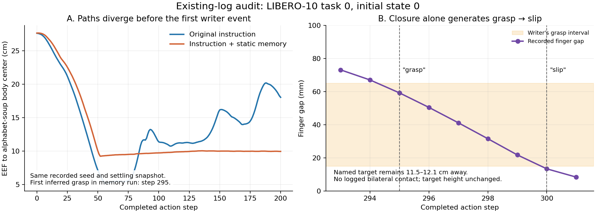

# SmolVLA text-memory logic audit — 2026-10-15

The compact run has a substantial regression against its matched no-memory baseline. Text-conditioning shift is a credible contributor, including before any dynamic memory event. However, the memory pipeline also emits unsupported named-object claims and reintroduces superseded events. Fine-tuning should follow a correction and validation of the memory contract; training on the current facts would mix robustness training with inaccurate state supervision.

## Scope and reproducibility

- Fixed analysis window: `libero_10_task0/init_0..9` and `libero_10_task1/init_0..4` from `experiments/results/v2_memory/prompt_shoren_obs_text`.
- Compact outcome: 1/15. This window does not expand as the live run continues.
- The WSL no-memory baseline has states 0..4 for these tasks. On those 10 shared episodes: no memory 8/10; compact memory 1/10. Task0: 3/5 versus 0/5; task1: 5/5 versus 1/5.
- Recorded seed, instruction, initial-state ID, executed horizon (10), checkpoint path, settling snapshot, Python/robosuite versions, model-config hash, and policy interface match for all 10 pairs. Model device is CUDA. These are recorded invariants, not proof of bitwise identical full observations or diffusion noise.
- Repository revision recorded by both runs: `6e5207842f53ca4606d2303fbb984be91aa5cb53`; dirty working trees. Compact run has a saved `git_diff.patch`; per-episode `git_diff_sha256` is null.
- Model manifest pins `lerobot/smolvla_libero@31d453f7edd78c839a8bbc39744a292686daf0de`; model file SHA-256 recorded there is `9a9f6413e42c0f332fccbce9a0dc796af2790f82cf002f791cdbf7e01e1afca8`. This audit did not rehash the large weights or load the policy.
- LIBERO manifest pin: `8f1084e3132a39270c3a13ebe37270a43ece2a01`.
- Independent token recount uses the locally cached official tokenizer JSON at revision `7b375e1b73b11138ff12fe22c8f2822d8fe03467`, with newline, special-token processing, and padding/truncation disabled for counting. Its SHA-256 is in `audit.json`.
- The former `pilot_obs_text` directory is no longer present when this audit is generated. The prior chat audit recorded 1/15 for the same first 15 episodes, but that is not revalidated here. A zero `count` for legacy in the JSON means unavailable data, not zero success.
- Classification: **LIBERO-derived diagnostic analysis; NON-COMPARABLE_OFFICIAL_PAPER**. All outcomes come from existing `episode.json` files. This work runs no benchmark or policy inference.

Reproduce from the repository root:

```powershell
python experiments/audits/memory_prompt_logic_20261015/audit_existing_logs.py
python experiments/audits/memory_prompt_logic_20261015/plot_evidence.py
```

The scripts use existing Python, NumPy, tokenizers, and matplotlib. They write only this audit directory. Input hashes, per-episode evidence, event telemetry, and matched initial action vectors are in `audit.json`.

## What the update actually fixed

The official tokenizer is now resolved via `input_tokenizer`; the renderer counts the same terminating newline and special tokens. Across all **1,438 replanning decisions** in this window:

| Check | Result |
|---|---:|
| Independent count differs from logged count | 0 |
| Prompt exceeds 48 tokens | 0 |
| Facts dropped for token budget | 0 |
| Writer replay differs from logged events | 0/15 episodes |
| Reconstructed retrieval/rendered prompt differs from trace | 0/1,438 decisions |

Writer replay uses the recorded action, post-action EEF position and finger joint positions, not a mocked environment. Renderer replay reconstructs only events available before each decision, preserving initialization order and the actual retrieval settings. These checks establish that the inspected implementation explains the logged behavior. They do not certify the truth of its facts.

The previous token-overflow issue is therefore not an explanation for these episodes. Shortening the text has left the semantic and grounding problems intact.

## Confirmed logic problems

### 1. Closing the gripper becomes a named grasp and then a slip

`src/memory/observation_writer.py:133` always selects the first target. At lines 160–162, a closing command, finger gap in [0.015, 0.065] m, and EEF z <= 0.95 m establish a `CONFIRMED` grasp. There is no object localization, image recognition, relative object motion, contact evidence, closure-velocity check, or minimum persistence requirement. An unobstructed closing gripper necessarily passes through that gap interval. When its gap subsequently falls below 0.015 m, the same writer reports a slip.

Concrete existing trace: task0/init0, alphabet soup:

| Completed action step | Gap (mm) | Distance to named target (cm) | Logged bilateral contact | Writer event |
|---|---:|---:|---|---|
| 294 | 67.10 | 11.56 | false | — |
| 295 | 59.28 | 11.60 | false | observed_grasp |
| 299 | 21.80 | 11.89 | false | — |
| 300 | 13.38 | 11.99 | false | observed_slip |

The named target's height stays unchanged. At decision 300, before executing action 300, the prompt says `Holding alphabet soup.` At decision 310 it says `Lost contact with alphabet soup.` This reproduces the closure-triggered false named-object assertion from actual data; the recorded fields do not independently identify all other possible contacts.

Across the fixed sample: 251 grasp events; 250 lack logged bilateral contact with the named target; 189 occur more than 10 cm from its body center. The contact field is an imperfect diagnostic, so these counts are not a calibrated false-positive rate. The distant, stationary-object examples are stronger evidence than the contact flag alone. Of 10 inferred lifts, six have named-target height change below 5 mm.

The hardcoded confidences (0.70–0.80) are not empirically calibrated by the shown code. Calling them `CONFIRMED` causes unqualified prose in the renderer.

### 2. Object identity and multi-object progress are absent

All dynamic events are assigned to the first parsed target: alphabet soup for task0, cream cheese for task1. Tomato sauce and butter only get initial `detected` entries. Initial detection is registered from the target-name list without inspecting the images passed to `on_episode_start`.

The writer never establishes `in_basket`, `placed`, or subtask-completed states. Opening the gripper only generates `released`, which does not imply placement success. Thus the current observation writer cannot provide the key historical fact for these tasks: which of the two objects has already been placed.

A particularly clear example is the successful task1/init1. BDDL telemetry records cream cheese in the basket at step 187 and butter at 378. Yet at decisions 250, 270, 320, 340, 350, and 370, memory says `Holding cream cheese.` At action 317 the cream-cheese body is already near the basket and 20.07 cm from the EEF. The writer has no mechanism to assign the new manipulation to butter.

### 3. A previous slip can override a newer release

`src/interfaces/text_memory.py:114` searches historical recovery events first. It skips an old slip only when the latest retrieved object state is `grasped`, `holding`, or `lifted`. It does not compare the slip's timestamp with a newer release/completion. The object is then added to `handled_entities`, suppressing its current state during object rendering.

Example: task0/init1, slip at 392; newer release at 450; decision 460 again says `Lost contact with alphabet soup.` There are **118 decisions** where a slip is rendered despite a newer release in the reconstructed store. This is superseded-event resurfacing, not evidence of a fresh slip.

Recovery claims occur in **723/1,438 decisions**. Prioritizing them makes the quality of the slip detector especially consequential.

### 4. Initialization facts permanently change the input even without useful memory

The initial task0 instruction is 13 tokens. Its compact prompt is 32 tokens:

```text
put both the alphabet soup and the tomato sauce in the basket. Memory: Alphabet soup is detected. Basket is target destination. Tomato sauce is detected.
```

The renderer also adds punctuation, changes capitalization, and changes the suffix format, so the update is not a pure length-only experiment.

The retriever expires ordinary states after 200 steps, but `target_destination` is durable. Consequently `Basket is target destination.` appears in **all 1,438 prompts**; **279 decisions** receive only that fact as memory. None receives the original instruction unchanged. At step 210, untouched object detections disappear, while the basket statement persists. This creates another text change without any physical event.

These statements duplicate the instruction and add no episode history. Even after invalidating unreliable manipulation claims, the current design keeps exposing the policy to an unfamiliar suffix.

## Evidence for text-conditioning sensitivity, and its limits

Matched initial settling snapshots and all checked metadata are identical. The first recorded action differs between no-memory and compact runs for each matched episode, before a dynamic writer event can occur. For task0/init0, action y is -0.09556 without memory versus -0.01639 with the static suffix. These are controller input values, not meters.

In task0/init0, the first dynamic writer event occurs at 295. The trajectory has already diverged substantially during steps 0–200 while the suffix contains only initial facts. In particular the compact run stalls around 9–10 cm from the named target. This rules out *later inferred grasp/slip facts as the sole explanation* of the early difference. It is consistent with sensitivity to the static memory suffix and then closed-loop compounding.



However, the artifacts do not preserve complete raw model inputs and exact diffusion-noise tensors at each inference. Matching scalar seeds is not a substitute for a same-observation, same-noise intervention. The strongest causal confirmation still requires that intervention and paired rollout ablations. No attention measurements were made; this audit cannot claim attention dilution or prompt memorization as proven mechanisms.

The official implementation concatenates image, language, and state embeddings and conditions action generation on them; language is not an isolated side-channel. Adding unmasked language tokens also changes the conditioning sequence and positions used for later tokens. Remaining within a 48-token budget does not imply that the semantic input is in-distribution.

The local checkpoint config sets `train_expert_only=false` and `freeze_vision_encoder=false`. Do not assume that every training detail of the original paper's frozen-VLM experiments describes this exact checkpoint. The policy is frozen during this evaluation; that is a different statement from how it was trained.

One additional diagnostic concern: task1/init2 contains a large physical excursion (named-object height delta reaches 6.022 m). Its `ever_lifted=true` flag is not evidence of successful grasp/lift. Review that episode as a collision/trajectory instability case. This audit does not establish corrupt geometry or changed controller parameters.

## Recommended order of work

1. Correct the memory contract: separate task-declared entities from observed detections; emit no context when there is no validated historical fact. Represent insufficient evidence explicitly. Do not assert named-object grasp without identity grounding. Require persistent evidence for closure obstruction; a gap threshold alone cannot determine object identity or placement. Compare changes against the existing independent diagnostic signals in shadow mode.
2. Resolve temporal conflicts before rendering: current evidence must supersede earlier grasp/slip cycles. A newer release or verified placement must not resurrect an old recovery statement. Preserve achieved subtask states when supported, while invalidating them when contradictory evidence appears.
3. Run a small fixed, balanced ablation on task0/task1 states0..4 with the same execution stack: original prompt; shadow; static initial suffix only; validated dynamic facts. Keep each intervention explicit. A diagnostic oracle condition can separate writer error from policy consumption, but must remain labeled privileged-information research.
4. For mechanistic attribution, replay the exact same raw RGB/state observation and identical flow-matching noise under each text condition. Compare normalized and unnormalized chunks, then validate in closed-loop rollouts. Do not reconstruct missing model views from a single recorded video.

Expected interpretation: off≈shadow but static suffix fails supports text-conditioning shift. Static succeeds but observation facts fail points toward content/temporal errors. Correct facts still fail supports the need to train the policy to consume memory. These alternatives can coexist.

## Fine-tuning decision

Fine-tuning is a reasonable V2 research direction if the intended policy input includes memory. It is not a repair for an estimator that cannot identify the manipulated object. Fix and freeze the memory format and evidence semantics before producing training pairs.

Train on causal tuples `(image_t, state_t, original_instruction + memory_at_t, expert_action_chunk_t)`, with memory constructed only from evidence available by time t. Use pinned official demonstrations and preserve their action/state/preprocessing contract. Merely repeating fine-tuning with the original static task strings does not train memory consumption. Replaying failed policy actions as expert targets is also not appropriate.

Start with a bounded adaptation experiment, e.g. the action expert or supported LoRA, while preserving the original checkpoint as a separate baseline. The installed LeRobot source supports expert q/v projections plus state/action projections for default SmolVLA PEFT. This is a starting hypothesis, not a guaranteed optimal layer selection; language-backbone adaptation may be necessary if expert-only adaptation is insufficient. The published PEFT example's learning rates and rank are not validated hyperparameters for this memory experiment.

Include memory dropout and original-prompt examples to measure and limit loss of baseline ability. Validate unknown/empty memory behavior. Use episode-level held-out splits before generating memory labels; exclude evaluation rollouts and test initial states from training data selection. Oracle-derived training labels, if used, must be declared and assessed for train/deployment mismatch.

The evaluation needs an equally fine-tuned no-memory control as well as the original frozen baseline. Otherwise an improvement may come from extra training rather than memory. Evaluate the adapted model with correct, empty, and deliberately mismatched memory as explicitly labeled diagnostics; recovering baseline success by ignoring memory is not evidence of useful memory consumption.

## Primary references

- [SmolVLA paper v1](https://arxiv.org/html/2506.01844v1): architecture and original training recipe.
- [Official checkpoint config at pinned revision](https://huggingface.co/lerobot/smolvla_libero/blob/31d453f7edd78c839a8bbc39744a292686daf0de/config.json).
- [Official checkpoint preprocessor at pinned revision](https://huggingface.co/lerobot/smolvla_libero/blob/31d453f7edd78c839a8bbc39744a292686daf0de/policy_preprocessor.json).
- [LeRobot PEFT documentation](https://huggingface.co/docs/lerobot/peft_training), consulted 2026-10-15; implementation cross-checked against installed LeRobot 0.6.1 source.
- [LIBERO-Para v1](https://arxiv.org/html/2603.28301v1): independent evidence that instruction variation can impair other VLA policies. The inspected version does not evaluate this SmolVLA checkpoint and does not establish the cause of this run's failures.
